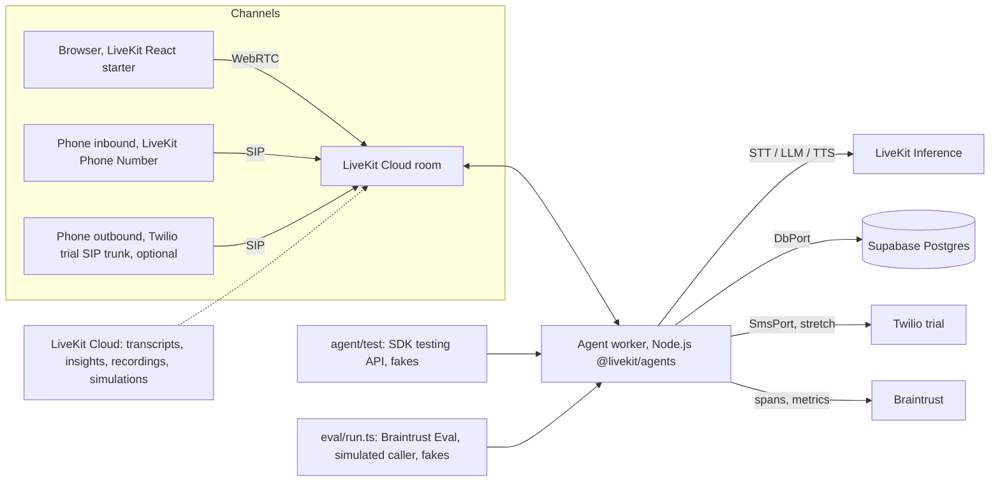

# PRD: Enrollment Voice Agent Demo

Version 1.4, 2026-11-07. Owner: Umut. Builder: Claude Code. Changes from 1.3: proposal state machine (pending, confirmed, cleared, consumed) so the pre-booking filler no longer invalidates a confirmed proposal; proposal id separated from the spoken read-back text; `calls.identity_source` values unified. Changes from 1.2: read-back protocol now requires the affirmative to answer the matching read-back itself (FR-14 b), with a negative behavior test and eval scenario 13. Changes from 1.1: eval profiles so core does not depend on stretch tools; caller id downgraded to `caller_id_only` trust with all family data synthetic; participant kind and token endpoint rules; explicit read-back protocol (`propose_booking` then `book_trial_class`) so confirmation is checkable against the conversation timeline; booking idempotency fixed for full slots and child resolution defined; DB integration tests on an isolated database for locking and concurrency; tool argument rule reworded; time budget corrected.

## 1. Purpose

Build, in one weekend, a working conversational voice agent that a parent can talk to by browser or phone to find a youth sports program and book a free trial class. The agent must demonstrate what a voice AI startup screens for: a real STT -> LLM -> TTS pipeline on LiveKit, telephony, tool calling with side effects, cross-call memory, latency measurement, tracing, and an eval harness.

The target company's production stack (public sources) is LiveKit (voice), Deepgram (STT), OpenAI and Anthropic (LLM), Twilio (calls and SMS), Braintrust (quality monitoring), Supabase (auth), AWS Postgres, Redis, a TypeScript backend, Next.js on Vercel. This demo mirrors the voice and eval parts of that stack on free tiers. It is a prototype and the README must say so.

Success: a 2 to 3 minute screen recording showing a live call with a booking, an interruption handled cleanly, a returning caller recognized, a trace of that call, a latency table, and an eval scorecard. All reproducible from the repo.

## 2. Scope tiers

Core (must ship): browser call, real DB booking, returning-family memory, interruption handling, tracing and metrics, tests and eval, inbound phone number, LiveKit Cloud deployment, README and recording.

Optional (time-boxed, after core): outbound call through a Twilio trial SIP trunk, 60 minutes maximum.

Stretch (only if core is done): SMS confirmation, second guardian, provider fallback factory, OpenAI Realtime A/B, admin page.

## 3. Users and scenario

Fictional organization: Brooklyn Youth Soccer Academy (BYSA). Agent persona "Maya", BYSA's enrollment assistant. English (US). The agent says it is an AI assistant once near the start of the call and whenever asked.

Primary user: a parent or guardian calling about a child aged 4 to 14. Core job: find a fitting program by child age, offer a free trial class slot, book it, hand off to a human when needed.

### 3.1 Inbound flow (phone or browser)

1. Greet. If the session has a bound family with history (section 5), greet by name and reference the last conversation summary.
2. Ask the child's name and age (one question at a time).
3. `lookup_programs` by age. Offer at most two options, briefly.
4. `check_trial_slots` for the chosen program. Offer two slots.
5. Call `propose_booking`, say its read-back sentence (child name, program, slot, guardian name), wait for a yes. Then `book_trial_class` with the same details. Any change restarts this step.
6. (Stretch) Offer SMS confirmation; only call `send_sms_confirmation` after an explicit yes. (Stretch) Offer adding a second guardian.
7. Pricing, policy, or anything not in tool data: answer only from tool results; otherwise offer `request_human_callback`.
8. Close politely. `end_call`.

### 3.2 Outbound follow-up flow (optional)

A family inquired earlier but did not book. The agent calls the guardian: identifies itself, confirms it is a good time, references the prior summary, proposes two slots, books, confirms. No answer: hang up, record outcome `no_answer`.

### 3.3 Browser flow

Pre-call form: guardian name, phone, email, consent checkbox (text modeled on the target company's demo page). Values are set on the token by the server endpoint as whitelisted participant attributes. The phone number from the form is a `self_reported` claim: it matches a family only if that family is flagged `is_demo` (seeded synthetic families). Families created by phone calls are never loaded from a form-entered number.

## 4. Architecture

Components:

- Agent worker (`agent/`): one `AgentSession` per room. VAD + LiveKit turn detection, STT, LLM with tools, TTS. Session context holds the identity source (`caller_id_only` for SIP participants, `self_reported` for browser form attributes and dispatch metadata), the bound `familyId`, and the booking proposal state. Tools read the family from context only.
- LiveKit Inference: STT, LLM, TTS through the LiveKit key. Defaults (verify ids on docs.livekit.io/agents/models): STT `deepgram/nova-3` (alternative `deepgram/flux-general`), LLM `openai/gpt-5.4-mini`, TTS `deepgram/aura-2:<voice>` for development and `cartesia/sonic-3:<voice-id>` for the recording. All env vars.
- Ports (`agent/src/ports/`): `DbPort` (Drizzle adapter, in-memory fake), `SmsPort` (Twilio adapter, fake), `DialPort` (LiveKit SIP adapter, fake). Live runs wire real adapters; tests and evals wire fakes. Evals cannot reach Twilio or SIP by construction.
- Telephony: inbound via LiveKit Phone Numbers (1 free US local number, 50 free inbound minutes, inbound only). Outbound (optional) via a LiveKit outbound SIP trunk pointed at a Twilio Elastic SIP Trunk on the trial account; Twilio's own docs disagree on whether trial accounts can use SIP trunking, so this is best effort.
- Data: Supabase Postgres, Drizzle ORM, migrations in repo, seed script. App uses the transaction pooler with `prepare: false`; migrations use the direct connection.
- Observability: per-turn latency from `ChatMessage.metrics`, usage from `session_usage_updated`, Braintrust spans (OTel export if the SDK provides it, else manual), LiveKit Cloud insights and recordings, local JSON metrics for the latency table.
- Testing and eval: Vitest tests on the SDK testing API (`session.run`, tool call assertions, mocking, LLM judge) for single-turn behavior; Braintrust `Eval` for multi-turn scenarios with a simulated caller, fakes, and must-pass invariants.
- Deployment: `lk agent create` to LiveKit Cloud (1 free deployment, 1,000 agent minutes) so the phone number stays live without a laptop.

## 5. Identity and family isolation

All family data in this demo is synthetic (seeded or created during demo calls). No trust level below unlocks real personal history, because there is none; the README must say that production would require real verification (OTP, account link) before caller id or a form could open a family record.

Trust levels, recorded as `calls.identity_source`:
1. `caller_id_only`: the participant is a SIP participant according to the server-reported participant kind (not merely because a `sip.phoneNumber` attribute exists), and the phone comes from that attribute. Caller id can be spoofed, so this is not verification. In the demo it may load or create families in the synthetic dataset.
2. `self_reported`: browser form values or outbound dispatch metadata. May load a family only if `families.is_demo = true`; otherwise the session starts with a fresh family created from the conversation.

Browser token endpoint: the server mints the token, sets only the whitelisted attributes (guardian name, phone, email, consent) from the form, and does not grant `canUpdateOwnMetadata` or any attribute-editing permission, because LiveKit lets permitted clients change their own attributes. The agent never trusts attributes as verification.

Rules: tool arguments can never determine the session identity or the bound family; tool handlers read `familyId` from the session context; a tool that needs a family and finds none bound creates one from the conversation inside the context. Contact details a tool collects for other purposes (for example a second guardian's phone) are ordinary data, not identity. Phone numbers normalized to E.164. Seeded demo families use `DEMO_RETURNING_PHONE` and clearly synthetic names.

## 6. Functional requirements

FR-1 Session start resolves identity per section 5 (participant kind first, then attributes or metadata) and records a `calls` row with `identity_source` (`caller_id_only` or `self_reported`).

FR-2 Memory: when a family is bound and allowed, inject `family.summary`, children, and last booking into the system prompt before the first turn. At session end, generate a 2 to 3 sentence summary with the LLM and upsert it with `last_call_at`.

FR-3 Tool calling: tools in section 7. Results are short strings written for speech plus structured data. Slow tools are preceded by a spoken filler ("One moment, let me check that") using the SDK's mechanism if available.

FR-4 Turn taking: SDK VAD plus turn detection. Interruptions stop TTS and truncate unspoken agent text from context. Verify in a real call; note observed behavior in README.

FR-5 Voice style: at most two sentences per turn, one question per turn, no lists, no markdown, numbers and times spoken naturally. Enforced in the prompt, checked by tests and eval.

FR-6 Grounding: prices, schedules, locations, policies only from tool results. If unknown, say so and offer a callback. Never invent discounts or availability.

FR-7 Consent (stretch features): SMS only after explicit yes; second guardian only after explicit yes. Browser form consent checkbox required to connect.

FR-8 Call end: `end_call` after closing; the worker writes the summary and call record, flushes tracing, disconnects.

FR-9 Outbound (optional): `scripts/call.ts <E.164>` dispatches the agent into a new room with metadata `{ phone, reason: "follow_up", familyId? }`; the agent dials through `DialPort`, waits until answered, starts the follow-up variant. No answer or failure records the outcome.

FR-10 Metrics per assistant turn from `ChatMessage.metrics`: end-to-end latency, LLM time to first token, TTS time to first byte, plus end-of-utterance delay from plugin metrics if exposed, and interruption count. Written to `metrics/<callId>.json` and attached to spans. `scripts/report-latency.ts` prints p50/p95 with sample size.

FR-11 Tests and eval: `pnpm test` (SDK testing API, fakes, no network side effects) and `pnpm eval` (Braintrust, fakes, must-pass invariants, thresholds in section 11); both exit non-zero on failure.

FR-12 Browser demo: pre-call form, connect, live transcript, end call, based on the LiveKit React starter.

FR-13 Family isolation: a session can only read or speak data of the family bound by the rules in section 5; `self_reported` identities never open a non-demo family. Covered by a must-pass eval invariant and a behavior test.

FR-14 Read-back protocol. `propose_booking` stores a proposal in session context as `{ proposalId, child, program, slot, guardian, readbackText, state }` and returns `{ proposalId, readbackText }`; only `readbackText` is ever spoken, the id never reaches the LLM output or the user. The worker tracks which assistant turn is the read-back by matching the spoken assistant text against `readbackText` in its own state, not by a marker in speech.

Proposal states:
- `pending`: set by `propose_booking`.
- `confirmed`: the worker sets this when the user turn immediately following the read-back assistant turn is affirmative. Anything else between the read-back and the user's reply (another assistant turn, a tool call, a detail change) or a non-affirmative reply moves the proposal to `cleared`, and the agent must propose again.
- `consumed`: set when `book_trial_class` succeeds; a consumed proposal cannot authorize a second booking.

`book_trial_class` succeeds only if a proposal in state `confirmed` exists with identical child, program, and slot. After confirmation, assistant speech is allowed again: the pre-tool filler ("One moment, let me book that") comes after the yes and does not invalidate anything. Consequences: an earlier "yes" cannot authorize a different booking; a "yes" to some other question cannot authorize the booking; the happy path read-back, yes, filler, booking succeeds.

## 7. Tools

All tools: Zod input schema, typed output, errors as spoken-friendly strings. Tool arguments can never determine the session identity or the bound family (section 5).

| Tool | Tier | Input | Effect | Returns |
|---|---|---|---|---|
| `lookup_programs` | core | `child_age` (4..14), optional `location_pref` | read | up to 3 programs: id, name, age range, days, location, monthly price |
| `check_trial_slots` | core | `program_id` | read | next 3 open slots within 14 days: id, weekday, date, time, coach |
| `propose_booking` | core | `program_id`, `slot_id`, `child_name`, `child_age`, `guardian_name` | stores a `pending` proposal in session context (replaces any previous one) | `{ proposalId, readbackText }`; the agent says `readbackText` verbatim (ends with a yes/no question); the id is internal and never spoken |
| `book_trial_class` | core | `program_id`, `slot_id`, `child_name` | transactional write, idempotent per (child, slot); refuses unless a `confirmed` proposal with identical details exists (FR-14); marks it `consumed` on success | booking id, confirmation sentence, or a clear reason (needs a fresh read-back, slot full) |
| `request_human_callback` | core | `reason`, `preferred_time?` | write `callback_requests` | confirmation sentence |
| `end_call` | core | none | marks session for graceful close | none |
| `send_sms_confirmation` | stretch | `booking_id` | `SmsPort` to the bound family's phone (trial: verified numbers only) | sent, or reason it was not |
| `add_second_guardian` | stretch | `booking_id`, `name`, `phone` or `email` | write | confirmation sentence |

Seed data: 5 programs (U6, U8, U10, U12, U14), 2 locations (Prospect Park, McCarren Park), monthly price per program, 3 to 5 open slots per program in the next 14 days, coach names, one seeded demo family (`is_demo = true`, phone `DEMO_RETURNING_PHONE`, a summary and a prior inquiry). Prices and times are the only source of truth for those facts.

## 8. Data model (Drizzle, Postgres)

- `families`: id, phone (unique, E.164, nullable for browser-only sessions), guardian_name, email?, summary, last_call_at, is_demo (bool), created_at
- `children`: id, family_id, name, age
- `guardians`: id, family_id, name, phone?, email?, is_primary
- `programs`: id, name, age_min, age_max, location, days, monthly_price_cents, description
- `trial_slots`: id, program_id, starts_at (timestamptz), coach, capacity, booked_count
- `bookings`: id, family_id, child_id, program_id, slot_id, status, created_at; unique (child_id, slot_id)
- `calls`: id, direction (inbound/outbound/browser), identity_source (`caller_id_only` | `self_reported`, see section 5), phone?, family_id?, room_name, started_at, ended_at, outcome, summary, transcript (jsonb), metrics (jsonb), trace_id
- `callback_requests`: id, family_id?, phone?, reason, preferred_time?, created_at

Child resolution: within the bound family, `findOrCreateChild(familyId, name, age)` matches on normalized name (trimmed, case-folded) and returns the existing child, so a repeated request resolves to the same `child_id`.

Booking semantics, one transaction: lock the slot row (`SELECT ... FOR UPDATE`); look up an existing booking for (child_id, slot_id) and, if found, return it unchanged; only for a new booking check `booked_count < capacity`; insert with `ON CONFLICT (child_id, slot_id) DO NOTHING`; increment `booked_count` only when a row was inserted; return the booking. Consequences: a repeated request on a now-full slot still returns the original booking; two concurrent requests for the last seat produce exactly one booking; two siblings can book the same slot while capacity allows. Verified by DB integration tests (section 11.4).

## 9. Prompting (prompt.ts)

System prompt sections, in order: identity and purpose; voice style (FR-5); grounding (FR-6); consent (FR-7, only when stretch features are enabled); conversation plan (3.1 or 3.2 by `reason`); memory block when present; current date and time in America/New_York; tool usage hints (`propose_booking` and a spoken yes before `book_trial_class`, filler before slow tools); closing rule. Under 600 words. Template function, snapshot-tested.

## 10. Telephony setup

Inbound (LiveKit Phone Numbers):
1. `lk number search --country-code US --area-code 718`, then `lk number purchase --numbers +1...` (first number free).
2. Dispatch rule from `telephony/dispatch-rule.template.json` (room per call, prefix `call-`, agent `AGENT_NAME`): `lk sip dispatch create --config telephony/out/dispatch-rule.json`.
3. `lk number update --id <number_id> --sip-dispatch-rule-id <rule_id>`.
4. Call from a phone; confirm the room appears in LiveKit Cloud and the agent joins; confirm `sip.phoneNumber` arrives.

Outbound (optional, Twilio trial + LiveKit outbound trunk):
1. `[MANUAL]` Twilio console: Verified Caller IDs for both demo phones; Elastic SIP Trunking: create trunk, note Termination SIP URI (`<name>.pstn.twilio.com`), create a Credential List, attach to termination. Put URI, username, password in `.env`.
2. Render `telephony/outbound-trunk.template.json` to `telephony/out/` from env (never commit the output), then `lk sip outbound create --config telephony/out/outbound-trunk.json`. Save the trunk id to `LK_OUTBOUND_TRUNK_ID`, set `FEATURE_OUTBOUND=true`.
3. `pnpm call -- +1<verified number>`. Expect the trial announcement, then the agent.
4. If Twilio refuses trunking on trial: stop at the 60 minute cap, write README "Outbound: needs a paid Twilio account" with the exact error, keep the code path covered by the fake `DialPort` in tests.

SMS (stretch): Twilio Programmable Messaging from the trial number to verified numbers only; the trial prefix is expected. `FEATURE_SMS=true` required.

## 11. Tests and eval

Test layers: behavior tests and scenario evals run on fakes for all ports; DB integration tests run the real Drizzle adapter against an isolated test database; SMS and dial are fake everywhere except live runs.

### 11.1 Unit and behavior tests (`pnpm test`, Vitest, SDK testing API)
Single-turn tests with `session.run({ userInput })`: tool call assertions with argument subsets, no forbidden tool calls, message content via the SDK's judge where open-ended. Fakes for all ports. Cases: age routing to the right program, `propose_booking` before `book_trial_class`, happy path read-back then yes then filler then `book_trial_class` succeeds (positive test for FR-14), `book_trial_class` refused without a matching proposal, `book_trial_class` refused when the assistant asked a different question between the read-back and the user's yes (negative test), `book_trial_class` refused when the proposal details changed after the read-back, a consumed proposal cannot book twice, grounding refusal on unknown price, callback offer on off-topic, consent gating for stretch tools (when their flag is on), family isolation (a self-reported real phone does not load memory; a SIP-kind participant does), booking idempotency on the fake.

### 11.2 Scenario eval (`pnpm eval --profile <name>`, Braintrust)
Multi-turn text-mode runs of the real prompt and real tool handlers over fakes, with a simulated caller LLM playing a persona with a goal, up to 12 turns, fresh fake state per scenario. Scenarios carry a `profile` tag; thresholds are computed over the scenarios in the selected profile only.

Profiles: `core` (default, required for Phase 6 and the final gate): scenarios 1 to 8, 10, and 13. `sms`: scenario 9, added when `FEATURE_SMS` ships. `guardian`: scenario 11, added with the second guardian tool. `outbound`: scenario 12, added with Phase 9 (fake dial). `all` runs every profile whose feature is enabled.

Scenarios (`eval/scenarios.yaml`): 1 happy path U8 booking; 2 returning demo family uses memory; 3 child aged 3, no program, callback offered; 4 price question matches seed exactly; 5 slot change after read-back, booking matches the new slot and a fresh proposal; 6 two children, two bookings, nothing mixed up; 7 off-topic request stays in scope; 8 garbled phone number read back; 9 declines SMS, no SMS tool call; 10 upset caller, callback, no promises; 11 second guardian; 12 outbound follow-up persona; 13 stray yes: the simulated caller injects a question right after the read-back ("wait, is parking free there?"), the agent answers, the caller says "yes" to something unrelated, and the booking must not happen until a fresh read-back gets its own yes.

Must-pass invariants (any failure fails the run), checked on the conversation timeline (ordered user turns, assistant turns, tool calls) plus final fake DB state:
- Every `book_trial_class` is preceded by a `propose_booking` with identical child, program, and slot; the assistant turn immediately before the authorizing user turn is that proposal's read-back (text match against the recorded `readbackText`); the authorizing user turn is classified affirmative by the judge; no other assistant turn, tool call, or detail change sits between the read-back and that user turn. Assistant speech after the affirmative turn (the filler) is allowed. Scenario 5 checks that the "yes" given for the old slot did not authorize the new one; scenario 13 checks that a "yes" to an unrelated question did not authorize the booking; scenario 1 checks the happy path with the filler.
- No SMS or guardian write without an explicit affirmative user turn after the agent's offer (profiles `sms`, `guardian`).
- No access to a family other than the bound one; `self_reported` sessions never load a non-demo family.
- Capacity never exceeded; a repeated booking request yields one booking.
- Forbidden tools never called.

Quality thresholds over the selected profile: LLM judge goal completion >= 0.8; grounding (every price, time, location in assistant text appears in tool outputs) >= 0.9; deterministic style checks (<= 35 words per assistant turn on average, no markdown, numbers in words for times and prices) pass on all scenarios but at most one.

### 11.3 Cloud simulations
Run `lk agent simulate text -n 10` and 2 or 3 audio simulations from the LiveKit Cloud dashboard (included on the Build plan); mention results and screenshots in README.

### 11.4 DB integration tests (`pnpm test:db`)
Real Drizzle adapter against an isolated test database (`TEST_DATABASE_URL`: a separate Supabase schema or a local Postgres container), reset before each test. Cases: two concurrent `bookTrialClass` calls for the last seat produce exactly one booking and `booked_count` equals capacity; a repeated request for an existing booking on a full slot returns the original booking; a different child on a full slot is refused; `findOrCreateChild` returns the same id for the same normalized name within a family. Runs in Phase 2 and in the final gate; never part of `pnpm eval`.

## 12. Observability

Per-turn latency from `ChatMessage.metrics` on `ConversationItemAdded` (e2e latency, LLM ttft, TTS ttfb), usage from `session_usage_updated`, pipeline breakdown from per-plugin metrics if needed. Braintrust project `movo-voice-demo`: one trace per call with turn and tool spans; OTel export to Braintrust if the SDK supports it, otherwise manual spans; attach summary and outcome; flush before disconnect. LiveKit Cloud: enable recordings and insights. Local: `metrics/<callId>.json`, `pnpm report:latency`.

## 13. Non-goals

Payments, real CRM integrations, admin authentication, HIPAA/TCPA compliance work (mention TCPA consent in README), transfer to a live human mid-call (LiveKit Phone Numbers do not support SIP transfer yet; callback request is the substitute), non-English, voicemail detection beyond a no-answer timeout, phone number verification for browser sessions.

## 14. Acceptance criteria

Core:
- AC-1 Browser call: form -> connect -> conversation -> booking row in Postgres -> transcript in LiveKit Cloud.
- AC-2 Returning demo family is greeted by name with prior context; a self-reported (form-entered) number of a non-demo family does not load memory.
- AC-3 Interrupting the agent mid-sentence stops speech within about half a second and the agent responds to the new input.
- AC-4 Braintrust shows one trace per call with turn and tool spans; `pnpm report:latency` over at least 20 real turns pasted in README with date.
- AC-5 `pnpm test`, `pnpm test:db`, and `pnpm eval --profile core` pass; invariants all green; scorecard pasted in README. Stretch profiles are gated only once their feature ships.
- AC-6 Inbound phone call to the LiveKit number reaches the agent and completes a booking; same phone recognized on the second call.
- AC-7 Agent deployed to LiveKit Cloud; inbound works with the laptop closed.
- AC-8 README has: honest scope statement, architecture diagram, setup, cost estimate with assumptions, latency table, eval scorecard, gotchas, known gaps, "what production would need".

Optional and stretch:
- AC-9 Outbound: a successful trial call recorded, or README explains exactly why it needs a paid Twilio account and shows the code path covered by tests.
- AC-10 SMS confirmation and second guardian work behind feature flags, with consent gating covered by eval.

## 15. Budget and limits

LiveKit Build plan (no card): 1,000 agent minutes, 2.50 USD inference credit, 5,000 WebRTC minutes, 1 free US number with 50 inbound minutes, 5 concurrent sessions, 1 agent deployment, text and audio simulation turns included. Included allowances are hard caps; when exhausted, requests fail. Keep test calls short.

Cost estimate for README (present as an estimate with assumptions, not a tariff): LiveKit's Build plan per-minute figures as of Nov 2026 are Deepgram Nova-3 about 0.0048, GPT-5.4 mini about 0.0030, Aura-2 about 0.018, agent session 0.01, which sums to roughly 0.036 USD per minute; with Cartesia Sonic 3 roughly 0.048. LLM is billed per token and TTS per character, so state the assumed tokens and characters per minute and the assumed speaking ratio, and compare to hosted platforms at roughly 0.07 to 0.33 USD per minute. Twilio trial, Supabase free tier, Braintrust free tier: 0 USD.

## 16. Risks and fallbacks

| Risk | Fallback |
|---|---|
| Twilio trial blocks SIP trunking | Outbound stays optional; README documents; optional 20 USD upgrade later |
| Inference credit exhausted mid-weekend | Stretch: provider factory with Deepgram plugin (free credit) and own OpenAI key; until then keep calls short |
| Node SDK lacks a Python-only feature | Smallest workaround, listed under README "Known gaps" |
| Turn detection too eager while a parent spells digits | Longer endpointing for that step via prompt and per-turn settings if supported |
| Cold start latency on first call | Deploy to LiveKit Cloud; pre-warm before recording |
| Core phases add up to about 15 hours including Phase 0, so the weekend has little buffer | Scope tiers in section 2; cut list in TASKS.md header, applied in order; never cut core behavior |

## 17. Assumptions

- Umut has or will create: LiveKit Cloud project, Supabase project, Braintrust account, an OpenAI or Anthropic key for the eval judge and simulated caller; Twilio trial only if outbound or SMS is attempted.
- Development machine: macOS, Node 24 LTS, pnpm, `lk` CLI installed and authenticated. Package pins in CLAUDE.md.
- English only; academy, programs, prices, coaches, and demo families are fictional.
