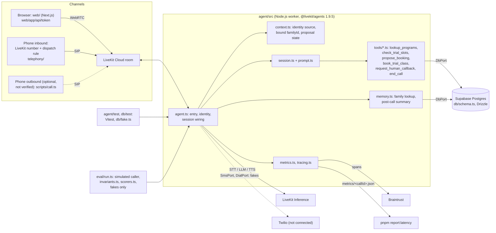

# movo-voice-demo

A weekend prototype of a conversational voice agent for youth sports academy enrollment. A parent
talks to "Maya" (an AI enrollment assistant for the fictional Brooklyn Youth Soccer Academy) by
browser or phone, finds a program for a child aged four to fourteen, and books a free trial class.

This is a prototype built as a credibility demo. It has production shape (ports, transactional
writes, identity rules, tests, evals, tracing) and prototype scope (one academy, synthetic data, free
tiers). It is not production software.

## Status

| Phase | State | Commit |
|---|---|---|
| 0 Accounts and local setup | done, OpenAI billing pending | see git log |
| 1 Scaffold and hello-world agent | done | see git log |
| 2 Database | done | see git log |
| 3 Context, tools, prompt, memory | done | see git log |
| 4 Browser demo | done | see git log |
| 5 Interruption, metrics, tracing | done | see git log |
| 6 Scenario eval | done | see git log |
| 7 Inbound phone | number bought, assignment pending Umut | see git log |
| 8 Hardening, deploy, docs | in progress: deploy running, docs | see git log |

Phase 7: number +1 929 428 8103 bought, dispatch rule created, rule assignment and the phone test
pending Umut.

Verified end to end today: browser calls (typed and spoken) with booking and summary on the booked
page, Braintrust traces with nested spans, metrics files and `pnpm report:latency`,
`pnpm eval --profile core` PASS (10/10), `pnpm test` 44/44, `pnpm test:db` 6/6.

Mocked: `SmsPort` and `DialPort` (fakes in live runs too, no Twilio).

Not done: outbound (Phase 9), SMS and second guardian (stretch), the Cartesia quality check, audio
simulations, the human phone test, the half-second interruption timing.

## Scope

This is a weekend prototype. It has production shape (ports, transactional writes, identity rules,
tests, evals, tracing) and prototype scope (one fictional academy, synthetic data, free tiers). It is
not production software.

What works today (verified in a real run, see Status):

- A browser call, typed or spoken, that books a trial class in Postgres.
- Returning-family memory and a post-call summary.
- The read-back protocol: a booking needs a confirmed proposal.
- Booking semantics (locking, idempotency) on real Postgres (`pnpm test:db`).
- Braintrust traces with nested spans, metrics files and `pnpm report:latency`.
- A 10-scenario eval that passes (`pnpm eval --profile core`).

What is mocked:

- `SmsPort` and `DialPort` are fakes in every run, including live runs. `agent.ts` wires
  `FakeSmsPort` and `FakeDialPort`. No Twilio code runs.
- All family, program, price and slot data is synthetic.

What is not done or not verified yet:

- Outbound calls (Phase 9). The Twilio trial trunk is not set up (`FEATURE_OUTBOUND=false`).
- SMS confirmation and a second guardian (stretch). No Twilio account is connected
  (`FEATURE_SMS=false`).
- An inbound phone call by a human to the LiveKit number, and the second-call recognition of the
  same phone (AC-6). The dispatch rule is created but not yet assigned to the number.
- The Cartesia voice (`LK_TTS_MODEL_RECORDING`). Only the Deepgram voice ran.
- Audio simulations in LiveKit Cloud.
- The half-second interruption stop time (AC-3).
- Deployment to LiveKit Cloud: in progress, not yet verified with the laptop closed (AC-7).

Not in scope: payments, CRM, admin login, TCPA or HIPAA work, a live transfer to a human,
non-English, voicemail detection.

## Architecture



Notes:

- Tools read `familyId` from the session context only. Tool arguments never choose
  the family.
- Live runs use the Drizzle `DbPort`. Tests and evals use the in-memory
  `db/fake.ts`, so an eval cannot send an SMS or place a call.
- Dashed lines are paths that exist in code but are not exercised.

## Setup

Start from a clean macOS machine. You need accounts for LiveKit Cloud, Supabase
and Braintrust. Twilio is optional.

1. Install mise, then run `mise install` in the repo. This pins Node 24 and pnpm 12.
2. Run `brew install livekit-cli`, then `lk cloud auth`. Check with `lk project list`.
3. Run `cp .env.example .env`. Fill the lines marked FILL (LiveKit, Supabase,
   Braintrust). Never commit `.env`.
4. Run `pnpm install`. The build-script allow list is in `pnpm-workspace.yaml`.
5. Run `pnpm db:generate && pnpm db:migrate && pnpm db:seed`. Set
   `DEMO_RETURNING_PHONE` first, because the seed uses it for the demo family.
6. Run `pnpm test`, then `pnpm test:db`. Both must pass before you go on.
7. Run `pnpm -F agent dev`. The worker registers as `enroll-agent`.
8. In a second terminal, run `pnpm -F web dev`. Open http://localhost:3000.
9. Phone, optional: run `lk number search --country-code US`, then
   `lk number purchase --numbers +1...`. Run `pnpm telephony:render`, then
   `pnpm telephony:render && lk sip dispatch create telephony/out/dispatch-rule.json`. Assign the
   rule to the number in the dashboard (see Gotchas for the CLI failure).
10. Run `pnpm eval --profile core`. The scorecard prints to the terminal.

## Commands

```
pnpm -F agent dev          # worker against LiveKit Cloud (the SDK prefers `lk agent dev`)
pnpm -F agent console      # talk to the agent from the terminal (mic or text)
pnpm typecheck && pnpm lint
pnpm test                  # behavior tests, fakes only
pnpm test:db               # real adapter against TEST_DATABASE_URL
pnpm eval --profile core   # Braintrust scenario eval, fakes only
pnpm report:latency        # p50/p95 from metrics/*.json
pnpm telephony:render      # ${ENV} templates -> telephony/out/ (gitignored)
```

Debugging a conversation without audio, from `agent/`:

```
lk agent debugger start src/agent.ts
lk agent debugger say "Hi, I want to sign up my daughter."
lk agent debugger stop --chat-history
```

## Identity and trust

All family data in this demo is synthetic. Nobody can read real personal history
through it, because none exists. Production needs real verification first.

The worker decides how far to trust a caller from facts the server reports, never
from what the caller or the browser claims.

- `caller_id_only`: the room participant is a SIP participant, and the phone is
  the SIP caller id. It may load a family in the synthetic dataset. It is not
  verification, because caller id can be spoofed.
- `self_reported`: browser form values or outbound dispatch metadata. It may load
  a family only if that family is flagged `is_demo`. Otherwise the call starts
  with a new family.

(The level is stored in `calls.identity_source`.)

Rules:

- The participant kind decides the level. A `sip.phoneNumber` attribute alone does
  not make a call `caller_id_only`.
- The web token endpoint sets only four attributes: guardian name, phone, email,
  consent. It does not let the browser edit its own attributes or metadata.
- The bound family is set once at session start and lives in the session context.
  A tool argument cannot choose or change it.
- If a tool needs a family and none is bound, it creates one from the conversation.
- Details a tool collects for other reasons (a second guardian's phone) are
  ordinary data, not identity.
- Phones are stored in E.164. Validation uses `isPossible()`, so seeded `555`
  numbers pass.
- A must-pass eval invariant and a behavior test cover family isolation.

## Decisions

- 2026-11-07: LLM default is `openai/gpt-6.1-terra` (PRD said gpt-5.4-mini, which is a generation older and costs more on LiveKit Inference: 0.75/4.50 vs 1.00/5.00 USD per million tokens, but Terra is the current balanced tier). `openai/gpt-6-luna` (0.10/0.50) is the documented cheap swap. Eval judge: `gpt-6.1-terra`; simulated caller: `gpt-6-luna`.
- 2026-11-07: No `@livekit/agents-plugin-silero` or `-livekit`. The SDK bundles `inference.VAD({ model: 'silero' })` and `inference.TurnDetector()` (cloud EOT with local fallback). Dropping the plugins removed `onnxruntime-node` (85 MB) and all 8 high audit findings (adm-zip, sharp via `@huggingface/transformers`).
- 2026-11-07: `DIRECT_DATABASE_URL` points at the Supabase session pooler (port 5432), not the IPv6-only direct host, because this machine has no global IPv6. Same credentials, session mode, fine for migrations.
- 2026-11-07: `TEST_DATABASE_URL` is schema `test` on the same Supabase project via `?options=-c search_path=test`, not a local container.
- 2026-11-07: Relative imports use `.ts` extensions (`allowImportingTsExtensions`, `erasableSyntaxOnly`), so plain `node` (type stripping) and `tsx` both run the same files. `lk agent debugger` launches the agent with plain `node`.
- 2026-11-07: `config.ts` loads the repo `.env` itself when LiveKit variables are absent, so `lk agent dev|console|debugger` work without `--env-file`.
- 2026-11-07: Build scripts allowed in `pnpm-workspace.yaml` after reading each script: esbuild, protobufjs, sharp, @livekit/blingfire, @livekit/local-inference. `braintrust` (downloads a `bt` CLI binary) and `autoevals` (pnpm guard) stay blocked; the SDKs work without their scripts.

- 2026-11-07: The read-back affirmation is classified by a small LLM call (`makeLlmAffirmationJudge`, one word YES/NO/OTHER) only on the user turn right after the read-back; a failed call counts as not confirmed. No keyword matching in production code. Behavior tests inject a scripted judge for determinism; the LLM judge has its own test.
- 2026-11-07: The proposal machine is driven from the public `conversation_item_added` event (assistant and user messages) and `function_tools_executed`, not from the `onUserTurnCompleted` hook, because that hook does not fire for text input (`session.run`, debugger). `book_trial_class` awaits the in-flight verdict (`proposals.settle()`), with a 1.5 s grace window for the user-message event.
- 2026-11-07: `CONSOLE_SIMULATE_SIP_PHONE` is a dev-only knob honored only for fake jobs (`lk agent console|debugger`, no room) so the returning-family path can be exercised without a phone. It is ignored whenever a real participant exists.
- 2026-11-07: Supabase RLS enabled on every table in `public` and `test` without policies. The app connects as the table owner (`postgres`), which bypasses RLS; the default `anon` and `authenticated` PostgREST roles are blocked. The Supabase MCP flagged the open tables as critical.

- 2026-11-07: The live call page has a small "type instead of talking" input. It is not in the mockup; it lets a tester drive a booking without a microphone and it is how the Playwright checks run. Typed input interrupts the agent's speech like voice does.
- 2026-11-07: The React starter was pruned to what the three screens use (Next 15, React 19, livekit-client, components-react, server-sdk). Rive, xyflow, shiki, motion, shadcn, radix and the theme toggle were removed. Fonts come from `next/font/google` (Inter, Space Grotesk).
- 2026-11-07: The web app reads the repo `.env` through `next.config.ts` (`process.loadEnvFile`), so there is one secrets file. `web/.env.local` written by `lk app create` was deleted.
- 2026-11-07: `web/` is linted by the root ESLint config. `eslint-config-next` needs `@eslint/eslintrc`, which breaks under the `minimatch >= 11` audit override (no default export), so the starter's lint setup was dropped.

- 2026-11-07: The LiveKit number is +1 929 428 8103. No 718 or 347 numbers were available in the Build-plan inventory; 929 is the third NYC overlay code in the PRD list.
- 2026-11-07: Eval judge and simulated caller run on LiveKit Inference (`inference.LLM`, judge on `LK_LLM_MODEL`, caller on `openai/gpt-6-luna`) instead of a direct OpenAI key, because the OpenAI account has no active billing. No `openai` or `autoevals` package; scorers are small prompts plus deterministic checks.
- 2026-11-07: Eval invariants (`eval/invariants.ts`) read the proposal machine's recorded judge verdicts (`proposals.verdicts`) rather than re-classifying user turns, so the invariant checks what the worker itself decided; the read-back match uses the same token-overlap rule as the worker.

- 2026-11-07: `@opentelemetry/api`, `sdk-trace-node` and `exporter-trace-otlp-proto` are declared as direct dependencies of `agent/` at the exact ranges `@livekit/agents` already uses, so no new package enters the tree (pnpm strict mode needs the declaration to import them). CLAUDE.md's "none extra" holds in that sense.
- 2026-11-07: Braintrust gets both layers: the SDK's OpenTelemetry spans over OTLP and manual `call` and `tool:*` spans; the exporter re-parents SDK spans under the call span because the job root span never leaves LiveKit's provider. Details in SDK notes and Gotchas below.

- 2026-11-07: Deployed to LiveKit Cloud as agent `CA_mAZxE8eZW6PH` (`enroll-agent`, us-east) from a multi-stage `node:24-slim` image that installs only the `agent` and `db` workspace packages with `--frozen-lockfile --prod` and runs `node agent/src/agent.ts start` (no build step, no tsx: Node 24 strips types). `@livekit/agents` is also declared at the workspace root so `lk agent deploy` passes its preflight.
- 2026-11-07: LiveKit Cloud text simulations run against the real Supabase database (the worker has no simulation-mode switch yet); the two scripted scenarios did not book anything.

## SDK notes

Installed: `@livekit/agents` 1.9.5, `@livekit/rtc-node` 1.2.1, `livekit-server-sdk` 2.19.2,
`zod` 4.6.7, `drizzle-orm` 0.45.4, `postgres` 3.4.9, `braintrust` 3.43.0, `autoevals` 0.4.1,
`vitest` 4.1.12, `typescript` 5.9.3. CLI: `lk` 2.19.3.

- Agent definition: `defineAgent({ entry, prewarm?, onSessionEnd? })` as the default export, plus
  `cli.runApp(new ServerOptions({ agent: fileURLToPath(import.meta.url), agentName }))` guarded by
  `process.env.VITEST`. Subcommands: `dev`, `start`, `console`, `connect`, `download-files`.
- Session: `new AgentSession({ vad, stt, llm, tts, turnHandling, ttsTextTransforms, userData })`.
  `session.start({ agent, room: ctx.room })` connects the room itself when it is not connected yet.
- Models: `new inference.STT({ model, language })`, `new inference.LLM({ model })`,
  `new inference.TTS({ model, voice, language })`; string shorthands `provider/model[:voice]` also
  work. Model ids verified on docs.livekit.io/agents/models on 2026-11-07.
- Turn handling: `turnHandling.turnDetection: new inference.TurnDetector()`, `interruption.mode:
  'adaptive'`, `endpointing.mode: 'dynamic'`, `preemptiveGeneration.enabled`.
- Agent: `Agent.create({ instructions, tools, onEnter, onExit, onUserTurnCompleted })`. Greeting
  via `session.generateReply({ instructions })` inside `onEnter`.
- Tools: `tool({ name, description, parameters: z.object(...), execute(args, { ctx }) })`;
  `ctx.userData` is the session user data, `ctx.session` the session.
- Testing API: `session.run({ userInput }).expect.nextEvent().isMessage(...)`,
  `.containsFunctionCall({ name, args })`, `.noMoreEvents()`, `withMockTools(Agent, {...})`,
  `voice.testing.FakeLLM`. An LLM judge lives in `MessageAssert.judge`.
- Metrics: `ChatMessage.metrics` (`MetricsReport`: `e2eLatency`, `llmNodeTtft`, `ttsNodeTtfb`,
  `endOfTurnDelay`, `transcriptionDelay`, `onUserTurnCompletedDelay`, `playbackLatency`) on the
  `conversation_item_added` event; `session_usage_updated` for usage.
- Telemetry: `telemetry.setTracerProvider(provider, { allowPii })`, `telemetry.tracer`,
  `setupCloudTracer`, `flushCloudTraces`. OTel SDK is bundled, so an OTLP exporter to Braintrust
  is possible without extra packages (checked in Phase 5).
- Participant kind: `@livekit/rtc-node` `ParticipantKind.SIP` (3); SIP attributes arrive as
  `participant.attributes['sip.phoneNumber']`.
- Lifecycle: `defineAgent({ onSessionEnd })` runs after the primary session closes and the worker
  waits for it (default `sessionEndTimeout` 300 s); the summary and call row are written there.
  `session.shutdown()` closes the session only; the job ends when `ctx.shutdown()` is called, so
  the `close` event handler calls it.
- Tool filler: `ctx.filler('One moment...', { delay }, fn)` on the tool `RunContext` speaks only if
  the session stays idle for `delay` ms, so fast tools stay silent.
- Testing API: `session.run({ userInput }).wait()`; `result.expect.at(-1).isMessage({ role }).judge(llm, { intent })`;
  `containsFunctionCall({ name, args })` matches an argument subset. `nextEvent({ type })` returns a
  plain `EventAssert` without `judge`.
- Browser token flow: `TokenSource.endpoint('/api/token')` posts a `TokenSourceRequest` JSON with
  proto field names (`participant_attributes`, `room_config`); the response may use `server_url` /
  `participant_token`. `useSession(tokenSource, { agentName, participantAttributes })` forwards
  them; the route validates with Zod and copies only the four `movo.*` attributes to the token,
  without `canUpdateOwnMetadata`.
- Agent to browser state: `ctx.room.localParticipant.sendText(json, { topic: 'movo.state' })` on the
  worker, `useTextStream('movo.state')` in React (last stream wins). Transcripts arrive through
  `useSessionMessages()`; subscribe at app mount or the greeting is missed.
- `session.start({ inputOptions: { deleteRoomOnClose: true } })` deletes the room when the agent
  hangs up, which is how the browser learns the call ended.
- Console and debugger: `ctx.isFakeJob` is true, `ctx.connect()` is a no-op and there is no remote
  participant; `waitForParticipant()` would hang.
- Tracing (`agent/src/tracing.ts`, checked 2026-11-07 against `@livekit/agents` 1.9.5, `braintrust` 3.43.0, `@opentelemetry/sdk-trace-node` 2.12.0, `@opentelemetry/exporter-trace-otlp-proto` 0.220.0, `@opentelemetry/api` 1.10.0). The Node SDK emits OpenTelemetry spans (`agent_session`, `user_turn`, `agent_turn`, `llm_node`, `tts_node`, `function_tool`, ...). We follow the documented custom-provider pattern: a `NodeTracerProvider` with a `BatchSpanProcessor(OTLPTraceExporter)` plus `telemetry.FanoutSpanProcessor`, then `telemetry.setTracerProvider(provider, { metadata, registerSpanProcessor: (p) => fanout.add(p) })`. With the fanout in place, LiveKit Cloud tracing attaches its own processor to the same provider. The exporter posts to `https://api.braintrust.dev/otel/v1/traces` with `Authorization: Bearer <key>` and `x-bt-parent: project_name:movo-voice-demo` (source: docs.braintrust.dev/integrations/sdk-integrations/opentelemetry/send-traces-and-logs). Manual Braintrust spans (`initLogger` + `logger.startSpan`) cover what OTel does not: a root `call` span per session (input: identity source, room name), one `tool:<name>` child span per tool execution (arguments, output, `durationMs`, from `FunctionToolsExecuted`), and the final `{ summary, outcome, bookingIds, callbackIds }` logged on the root. One trace per call: the Braintrust SDK issues OTel-shaped ids (32-hex `root_span_id`, 16-hex `span_id`), so the exporter rewrites each SDK span into the call span's trace id and hangs top-level spans under the call span. The root span id is stored as `calls.trace_id`.
- The OTel packages are direct dependencies of `agent` at the same ranges `@livekit/agents` declares (`^1.9.0`, `^2.8.0`, `^0.220.0`). pnpm is strict, so an import needs its own entry. `@opentelemetry/api` is declared too: without it, pnpm resolved the exporter's peer to a second copy (1.9.1), while the SDK uses 1.10.0. One copy means one context manager and one `instanceof` world.

## Gotchas

- `pnpm install` on pnpm 12 fails with `ERR_PNPM_IGNORED_BUILDS` until build scripts are reviewed.
  The `pnpm.onlyBuiltDependencies` field in `package.json` is ignored now; use `allowBuilds` in
  `pnpm-workspace.yaml` (true or false per package).
- `pnpm -F agent dev` prints "dev mode is deprecated ... use `lk agent dev`". It still works; the
  worker registers as `enroll-agent`.
- `lk agent debugger start src/agent.ts` runs the file with plain `node`, so `.js`-suffixed
  imports of `.ts` files fail with `ERR_MODULE_NOT_FOUND`, and `-- --env-file=.env` did not reach
  the process. Fixed by `.ts` import extensions and self-loading `.env` in `config.ts`.
- Supabase direct host is IPv6-only. Without IPv6 use the session pooler on port 5432.
- The Chrome-driven Supabase password reset: a first attempt leaked the generated password into a
  tool log because of a shell piping mistake, so the password was reset a second time. The live
  password exists only in `.env`.

- drizzle-kit 0.31 writes `REFERENCES "public"."families"` into generated SQL, which pins foreign
  keys to `public` even when the migration runs in the `test` schema. `pnpm db:generate` strips the
  `"public".` qualifier with `sed` after generating; re-check any new migration for it.
- `pnpm -F db <script>`: workspace bins live in `db/node_modules/.bin`, not the root. Call
  `drizzle-kit` by name in the package script, not by path.
- `drizzle-orm` `migrate()` prints a NOTICE object (`CreateSchemaCommand`) when the migrations
  schema already exists. Harmless.
- The `test` schema once had foreign keys to `public` tables (first migration, before the sed
  fix). Fixed by dropping and recreating the schema, then migrating again.

- `lk agent debugger` ends the agent process as soon as the session closes, before `onSessionEnd`
  and the shutdown callbacks run, so end-of-call writes cannot be observed there. Use a real room.
- `lk agent debugger say` on a text turn never fires `onUserTurnCompleted`; events do.
- `libphonenumber-js` `isValid()` rejects the synthetic `555` numbers used in seeds and tests;
  `isPossible()` is used instead (caller id is never trusted as verification anyway).
- Shell trap: a `.env` line with a trailing `# comment` is parsed correctly by `node --env-file`,
  but `cut -d= -f2` in a shell keeps the comment. Read env values through node.

- Editing any file under `web/` while a browser call is live remounts the React tree (hook order
  changes), which disconnects the participant and ends the call. Finish the call first.
- `useSession` calls `prepareConnection()` on mount with the empty form, so the first `/api/token`
  request logs a 400 ("Enter your name") in the console. Harmless; the real start sends the form.
- The Playwright MCP resolves relative screenshot paths against its own workspace root
  (`~/Downloads/movo`), not the repo. Use absolute paths.
- The room name shows as `unknown` in `calls.room_name` for console sessions; real rooms are
  `web-<id>`.

- `lk number update --id <PN> --sip-dispatch-rule-id <SDR>` and the raw `PhoneNumberService/UpdatePhoneNumber`
  call both answered `invalid_argument: Failed to update phone number` for the freshly purchased
  number (retried over several minutes, with `id` and with `phone_number`). The dashboard path
  (Telephony, Phone numbers, more menu, Assign dispatch rule) is the fallback; the LiveKit Cloud
  session lives in a browser the agent cannot sign in to.
- `lk sip dispatch create` wants the `CreateSIPDispatchRuleRequest` shape with a `dispatch_rule`
  wrapper and snake_case fields; a bare rule object fails with `missing rule`.

- Braintrust's `x-bt-parent` header accepts a span slug (`span.export()`) to nest an OTLP trace under a span. The docs say so, but on 2026-11-07 every slug we sent got `403 Missing update access to span id trace, or the span does not exist`. The 403 also came 15 s after the span was flushed. `project_name:` and the logger slug both returned 200. Fix: send `project_name:` and move the SDK spans into the call trace ourselves (next item).
- The framework creates the job root span (`job_entrypoint`) before the entry function runs, on LiveKit's own provider. Our provider only exists once the entry runs, so every SDK span has a parent that never reaches Braintrust. Braintrust's logs table only lists traces that have a root span, so these spans would not show up. Without LiveKit Cloud tracing it is worse: each top-level SDK span starts its own trace. Fix: a wrapping exporter tracks the span ids this provider started. Before export, it sets every span's trace id to the call span's trace id, and it re-parents spans with a foreign parent or no parent under the call span. Only the Braintrust export sees the rewrite; LiveKit Cloud's processor gets the original span. Exports wait up to 15 s for `startCall`, so spans from before the call span exists (for example `room_connect`) also land in the call trace.
- Do not call `provider.shutdown()` in the job shutdown callback. Shutdown callbacks run inside the framework's `job_shutdown` span, and that span and `job_entrypoint` end after the callbacks. After them, the framework calls `forceFlush()` on the current provider (`flushJobTraces`). A shutdown would drop those last spans and would also stop LiveKit Cloud's processor, which sits in the same fanout. `TracingHandle.shutdown()` therefore flushes Braintrust first (the OTLP spans name the call span as parent), then calls `forceFlush()`. The whole step is capped at 9 s.
- `@opentelemetry/sdk-trace-node` 2.12.0 is marked deprecated on npm ("Use @opentelemetry/sdk-trace package"). `@livekit/agents` 1.9.5 still depends on it, so we stay on it to keep one copy of the SDK.
- Duplicate tool rows: the SDK's own `function_tool` OTel span and our manual `tool:<name>` span both appear in the trace. The manual span carries the parsed arguments, the output and `durationMs` in a form the Braintrust UI shows directly.
- Smoke test leftovers: six `call` traces with room names `scratch-<epoch ms>`, two standalone `agent_turn` traces, plus `slug-probe` and `probe_child` rows, are in project `movo-voice-demo` from the 2026-11-07 tracing check. Filter them out or delete them in the UI.

- `lk agent create` preflight reads only the root `package.json` dependencies (or an npm lockfile) and said "@livekit/agents not found" for this pnpm workspace. Declaring `@livekit/agents` at the root fixes it; the first deploy went through a scratch copy with a stub `package-lock.json`.
- A hand-rolled secrets parser kept an inline `# comment` as the value of an empty variable and every cloud job crashed on env validation. Build secrets files with Node's `util.parseEnv`, then `lk agent update-secrets --overwrite`.
- A local `pnpm -F agent dev` worker and the cloud deployment register under the same `enroll-agent` name and share dispatch. Stop the local worker before judging the cloud agent.
- The cloud simulation judge noted the agent answered a trial-availability question with the program's regular days instead of calling `check_trial_slots`; a prompt tuning candidate.

## Known gaps

- The OpenAI account has no active billing (429 "account is not active"). This no longer blocks
  evals: the judge and the simulated caller run on LiveKit Inference. `OPENAI_API_KEY` stays unused
  until billing exists.
- Browser AC-2 (form with `DEMO_RETURNING_PHONE` loads the demo family): the context test and the
  debugger run cover the code path; the browser check needs the real number typed by Umut.
- The LiveKit Cloud transcript/session view was not opened by the agent; session reports were
  uploaded (`Session report uploaded to LiveKit Cloud` in the worker log).
- AC-3 interruption timing: a live voice session showed `playout completed with interrupt` and truncated
  transcripts when the caller spoke or typed over the agent, so interruption handling works; the
  "about half a second" stop time still needs a person with a microphone to confirm.
- `pnpm audit --prod`: clean on 2026-11-07 after removing the two plugins and overriding `glob`
  and `minimatch`.

## Eval scorecard

`pnpm eval --profile core`, run on 2026-11-07 after the stay-in-scope prompt rule, pasted verbatim
(n = 10 scenarios, simulated caller on `openai/gpt-6-luna`, judges on `openai/gpt-6.1-terra`, all
through LiveKit Inference, fakes for every port). Braintrust experiment `core-2026-11-07`.

```
| id | scenario | turns | inv | goal | ground | style |
|---|---|---|---|---|---|---|
| 1 | Happy path U8 booking | 5 | ok | 1.00 | 1.00 | ok |
| 2 | Returning demo family uses ~ | 5 | ok | 1.00 | 1.00 | ok |
| 3 | Child aged 3, callback offe~ | 2 | ok | 1.00 | 1.00 | ok |
| 4 | Price question matches seed | 2 | ok | 1.00 | 1.00 | ok |
| 5 | Slot change after read-back | 5 | ok | 1.00 | 1.00 | ok |
| 6 | Two children, two bookings | 8 | ok | 1.00 | 1.00 | ok |
| 7 | Off-topic request stays in ~ | 3 | ok | 1.00 | 1.00 | ok |
| 8 | Garbled phone number read b~ | 6 | ok | 1.00 | 1.00 | ok |
| 10 | Upset caller, callback, no ~ | 2 | ok | 1.00 | 1.00 | ok |
| 13 | Stray yes does not book | 6 | ok | 1.00 | 1.00 | ok |
Totals: 2026-11-07, profile core, n=10, invariants 10/10, goal 1.00 (>= 0.8), grounding 1.00 (>= 0.9), style 10/10 (at most 1 fail), PASS
```

The `inv` column is the must-pass set from PRD 11.2 (read-back protocol, consent, isolation,
capacity and idempotency, forbidden tools). Scenario 5 proves the yes given for the old slot did not
authorize the new one; scenario 13 proves a yes to an unrelated question did not book.

## Cost estimate

This is an estimate, not a tariff. Rates are the LiveKit Build plan figures from
the PRD (Nov 2026). Check LiveKit's pricing page before you rely on them.

Assumptions (all are assumptions, not measurements):

| Item | Value |
|---|---|
| Agent turns per call minute | 4 |
| LLM input tokens per turn | 2,000 (prompt, tools, history) |
| LLM output tokens per turn | 60 |
| Speech rate | 150 words/min, 6 chars/word = 900 chars/min |
| Agent speaking ratio | 0.4 (base), about 0.65 (high) |
| Agent TTS chars per call minute | 360 (base), 600 (high) |
| Prompt caching | none counted |

Derived per call minute: 8,000 input tokens and 240 output tokens.

Dev pipeline, USD per call minute:

| Line | Rate | Base | High |
|---|---|---|---|
| STT nova-3 | 0.0048/min | 0.0048 | 0.0048 |
| LLM gpt-6.1-terra | 1.00 in, 5.00 out /M tok | 0.0092 | 0.0092 |
| TTS aura-2 | 30 /M chars | 0.0108 | 0.0180 |
| Agent session | 0.01/min | 0.0100 | 0.0100 |
| Total | | 0.0348 | 0.0420 |

LLM base math: 8,000 x 1.00 / 1e6 = 0.0080, plus 240 x 5.00 / 1e6 = 0.0012.

Recording pipeline (TTS swapped to cartesia/sonic-3 at 50 per M chars):

| Line | Base | High |
|---|---|---|
| STT, LLM, session (as above) | 0.0240 | 0.0240 |
| TTS cartesia/sonic-3 | 0.0180 | 0.0300 |
| Total | 0.0420 | 0.0540 |

So the demo costs about 0.03 to 0.05 USD per call minute. The PRD gives about
0.036 and 0.048. Those use a cheaper LLM line (0.0030, gpt-5.4-mini) and a TTS
line of 0.018. Our LLM default is `gpt-6.1-terra` (see Decisions).

Comparison: hosted voice platforms charge about 0.07 to 0.33 USD per minute
(PRD figure, not re-checked). This stack is cheaper per minute, but you run and
maintain it yourself.

Free-tier limits (PRD section 15, hard caps): 1,000 agent minutes, 2.50 USD
inference credit, 50 inbound phone minutes, 5 concurrent sessions. If the credit
covers only STT, LLM and TTS (assumption), the dev pipeline uses
0.0248 USD per minute, so 2.50 USD lasts about 100 minutes.

| Service | Cost |
|---|---|
| Twilio trial (not connected) | 0 |
| Supabase free tier | 0 |
| Braintrust free tier | 0 |

## What production would need

- Concurrency and worker scaling: the demo has 5 sessions and 1 deployment. Add
  autoscaling, load tests and per-provider rate limits.
- Failover and provider fallback: one provider per stage today. Add fallbacks for
  STT, LLM and TTS, plus retry and degrade rules.
- TCPA consent capture: only a browser checkbox today. Store timestamped consent
  per channel before any SMS or outbound call.
- Recording consent: none today. Add a spoken or written notice, region rules and
  a retention policy.
- PII handling and redaction: transcripts are stored in `calls`. Redact traces and
  logs, encrypt data, set retention, support delete on request.
- Verified identity for web callers: form values are self-reported. Require OTP or
  an account link before any family record opens. Apply the same rule to phone
  callers, because caller id can be spoofed.
- Warm transfer: a callback request is the only hand-off today. Add SIP transfer
  to a human with context.
- Answering machine detection for outbound: `DialPort` is a fake. Add detection,
  calling-hours rules and an opt-out list.
- Regression evals from production calls: scenarios are hand-written today. Build
  new ones from real calls.
- Secrets management: `.env` today. Use a secrets manager, rotation and
  per-environment keys.
- Observability alerts: metrics are local JSON. Alert on latency, failed bookings,
  error rate and spend.
