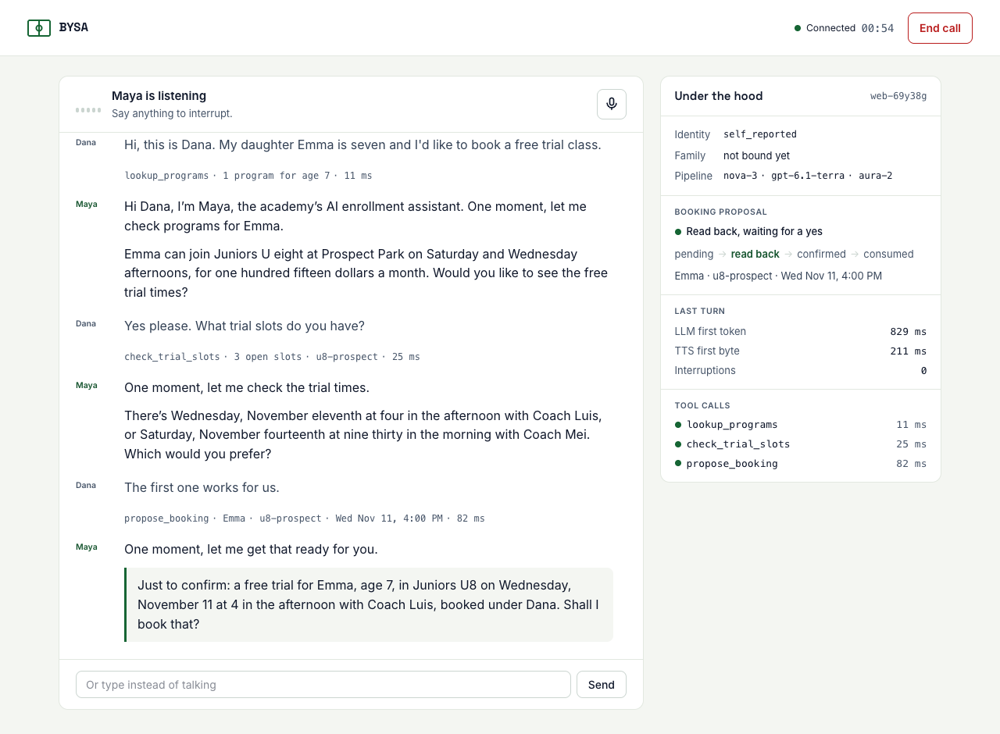
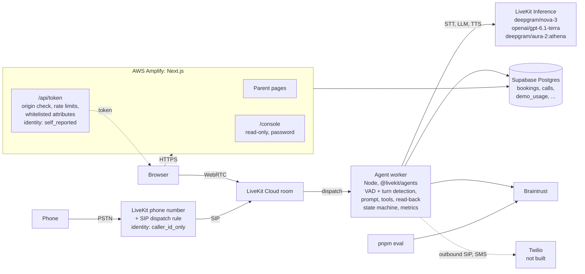
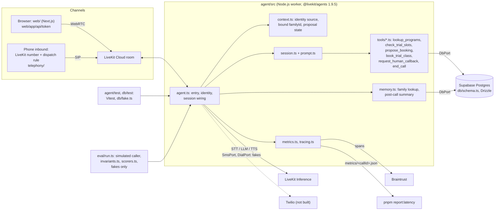

# movo-voice-demo

A voice agent for youth sports academy enrollment. A parent talks to "Maya", an AI
assistant for the fictional Brooklyn Youth Soccer Academy, by browser or phone, and books a free trial class.

Built on LiveKit Agents for Node, Supabase, Braintrust and Next.js. It is a demo built while
preparing for a voice AI engineering role: a prototype, not production software.

## Live demo

- Web: https://movo-voice-demo.umutcelik.com.tr
- Phone: +1 929 428 8103



## Demo limits

The public demo caps spend per UTC day:

- 2 browser calls per client IP.
- 10 calls in total (browser plus phone).
- 3 minutes (180 seconds) per call.

The web token route counts browser calls. The agent counts phone calls. Both write to the
`demo_usage` table, which stores only an HMAC of the IP. Over the cap, the form says today's limit is reached
and the phone line says it is closed for today.

The per-IP cap trusts `x-forwarded-for`, which a client can forge. The global cap is the real guard.

Set the limits with `DEMO_LIMIT_PER_IP_PER_DAY`, `DEMO_LIMIT_GLOBAL_PER_DAY` and
`DEMO_MAX_CALL_SECONDS`. Leave them unset in local development and no limit applies.

To pause the demo, set `DEMO_PAUSED=true` in the Amplify app env and the agent secrets, then rebuild
the web app and redeploy the agent. The form then disables "Start call", `/api/token` answers 503,
and the agent hangs up at once with no inference. Set it back to `false` the same way to resume.

The `demo_state` table is a second switch that needs no deploy. The demo is paused when either
switch says so:

- `pnpm demo:pause -- "<reason>"` pauses, `pnpm demo:resume` resumes, `pnpm demo:status` prints the row.
- The agent pauses it on its own when a model (STT, LLM or TTS) returns a credit, quota or auth
  error, and ends that call. A bare 429 pauses only after the SDK's retries give up.

## Alerts

An email goes to the owner through an AWS SNS topic when:

- `provider_credit`: a model returned a credit, quota or auth error. The same email says the demo
  was paused automatically (auto pause is part of this kind, not a separate one).
- `daily_limit`: the global daily cap was reached (token route or agent).
- `fail_closed`: a usage count or pause check failed, so calls are refused (token route or agent).

The same kind sends at most once per `ALERTS_COOLDOWN_HOURS` (default 6), tracked in the `alerts`
table. If the database is down, an in-process throttle keeps it to one email per process. An alert
never blocks or breaks a call: errors are logged and the publish has a short timeout. Without the
`ALERTS_*` variables, alerts are off and the agent logs that once. `pnpm alerts:test` sends one
`test` alert.

The SNS `Publish` call is signed with SigV4 in `db/alerts.ts`, so no AWS SDK package is installed.

## System architecture



The dotted token edge is the HTTPS reply to the browser. The dotted Twilio edge is not built: the SMS and dial ports exist as fakes only.

## What it does

- Takes a browser call (typed or spoken) or an inbound phone call.
- Finds a program for a child aged four to fourteen and offers trial slots.
- Reads the booking back and books only after a clear yes (the read-back protocol).
- Remembers a returning family and writes a post-call summary.
- Hands unanswerable questions to a human callback request.
- Writes bookings with locking and idempotency on Postgres.
- Records Braintrust traces, per-turn latency files and a 10-scenario core eval (3 more scenarios need tools that are not built).
- Shows calls, callbacks, families and quality in a read-only console.

Not built: outbound calls and SMS (the SMS and dial ports exist as fakes only). See the
[build report](docs/build-report.md) for the full status and known gaps.

## Quickstart

You need accounts for LiveKit Cloud, Supabase and Braintrust. Twilio is not used yet.

```
mise install                 # pins Node 24 and pnpm 12
brew install livekit-cli
lk cloud auth                # check with: lk project list
cp .env.example .env         # fill the lines marked FILL
pnpm install
pnpm db:generate && pnpm db:migrate && pnpm db:seed
pnpm -F agent dev            # worker registers as enroll-agent
pnpm -F web dev              # second terminal: http://localhost:3000
pnpm test
pnpm eval --profile core
```

Notes:

- Set `DEMO_RETURNING_PHONE` before the seed. The seed uses it for the demo family.
- `pnpm test:db` runs the real database adapter against `TEST_DATABASE_URL`.
- Never commit `.env`.

Other commands:

```
pnpm -F agent console      # talk to the agent from the terminal
pnpm typecheck && pnpm lint
pnpm report:latency        # p50/p95 from metrics/*.json
pnpm telephony:render      # ${ENV} templates -> telephony/out/
```

Debug a conversation without audio, from `agent/`:

```
lk agent debugger start src/agent.ts
lk agent debugger say "Hi, I want to sign up my daughter."
lk agent debugger stop --chat-history
```

## Deploy

- Agent: run `lk agent create` once from the repo root (it reads `livekit.toml` and the
  `Dockerfile`), then `lk agent deploy` for each update.
- Phone: run `lk number search --country-code US` and `lk number purchase --numbers +1...`.
  Then run `pnpm telephony:render` and
  `lk sip dispatch create telephony/out/dispatch-rule.json`. Assign the rule to the number in the
  dashboard. The templates are in `telephony/`.
- Web: follow [web/README-amplify.md](web/README-amplify.md) or
  [web/README-cloudflare.md](web/README-cloudflare.md).
- Set `ALLOWED_ORIGINS` (comma-separated) to the origins allowed to call `/api/token`.

## Project layout

```
agent/       worker: entry, prompt, tools, memory, metrics, tracing
db/          Drizzle schema, migrations, seed, in-memory fake
eval/        scenarios, simulated caller, scorers, invariants
web/         Next.js: parent pages, /api/token, /console
telephony/   SIP dispatch rule and trunk templates
scripts/     latency report, metrics export, telephony render
design/      reference mockups and screenshots
docs/        build report, build process, e2e evidence
```

## Code map



Notes:

- Tools read `familyId` from the session context only. Tool arguments never choose
  the family.
- Live runs use the Drizzle `DbPort`. Tests and evals use the in-memory
  `db/fake.ts`, so an eval cannot send an SMS or place a call.
- Dashed lines are paths that exist in code but are not exercised.

## Identity and trust

All family data is synthetic. Identity is never verified in this demo. The worker decides how far to trust a
caller from facts the server reports, not from what the caller claims.

- `caller_id_only`: a SIP participant, phone from caller id (spoofable).
- `self_reported`: browser form values. It loads a family only if the family is flagged `is_demo`.
- Tools read the bound family from the session context. A tool argument never chooses it.

The full rules are in the [build report](docs/build-report.md#identity-and-trust-full-rules).

## More

- [Build report](docs/build-report.md): status, decisions, gotchas, latency, eval scorecard, cost.
- [Build process](docs/build-process/README.md): the PRD, rules and task list a coding agent built this from.
- [License](LICENSE): MIT.

A write-up is planned.
