# End-to-end check of the live demo

- Date: 2026-11-07 (calls ran 12:19 to 12:27 UTC)
- Site: https://movo-voice-demo.umutcelik.com.tr (Next.js on AWS Amplify)
- Agent: LiveKit Cloud, pipeline shown in the aside as
  `nova-3 · gpt-6.1-terra · aura-2`
- Data: Supabase Postgres (read-only queries only)
- Browser: Playwright (Chromium), viewport 1280x900, typed input (no mic)
- Data used: synthetic only. Name "Dana Whitfield", phones (718) 555-0171,
  0172, 0173, emails at example.com. The real demo phone was never typed.
- Calls: 4 browser calls, each under 2 minutes (01:55, 01:39, 00:34, 00:14).
- Screenshots reshot on 2026-11-07 (evening) after the call and done page
  visual fixes, against a local production build (`next build` and
  `next start`) that dispatched the same cloud agent. Same scenarios, same
  synthetic name, phones (718) 555-0174 (B and E), 0175 (C), 0176 (D).
  Reshoot calls: B 01:48, C 01:48, D 00:30, E 00:15. The text below
  describes the first run; ids, durations and exact wording in the new
  screenshots differ (for example B is BK-229C749D). The Playwright browser
  had no microphone, so the mute button shows its muted state.

## Result table

| Scenario | Result |
|---|---|
| A Pre-call form | PASS (note: no inline message) |
| B New caller booking | PASS |
| C Stray yes guard | PASS (headline note) |
| D Off-topic and grounding | PASS |
| E Returning caller memory | PASS (non-demo path only) |
| F API checks | PASS |
| G Backoffice view | N/A, not built; tenant data listed |

## A. Pre-call form

Expected: Start call stays disabled without consent. A one-letter name is
rejected with a validation message.

Happened: the form loads with the three fields, consent box and a disabled
Start call. With valid fields and consent unchecked, the button is disabled.
With consent checked and the name "D", the button is also disabled. The page
shows no inline message for the short name: the client disables the button
(`guardianName.trim().length >= 2` in `pre-call-form.tsx`). The text
"Enter your name" exists only as the server answer (see F).

Result: PASS for the guard. The expected "validation message" is not shown
in the UI; the disabled button is the only signal.

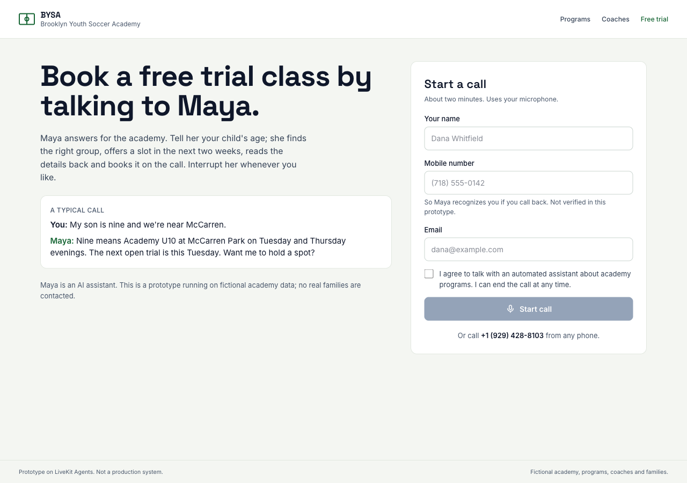
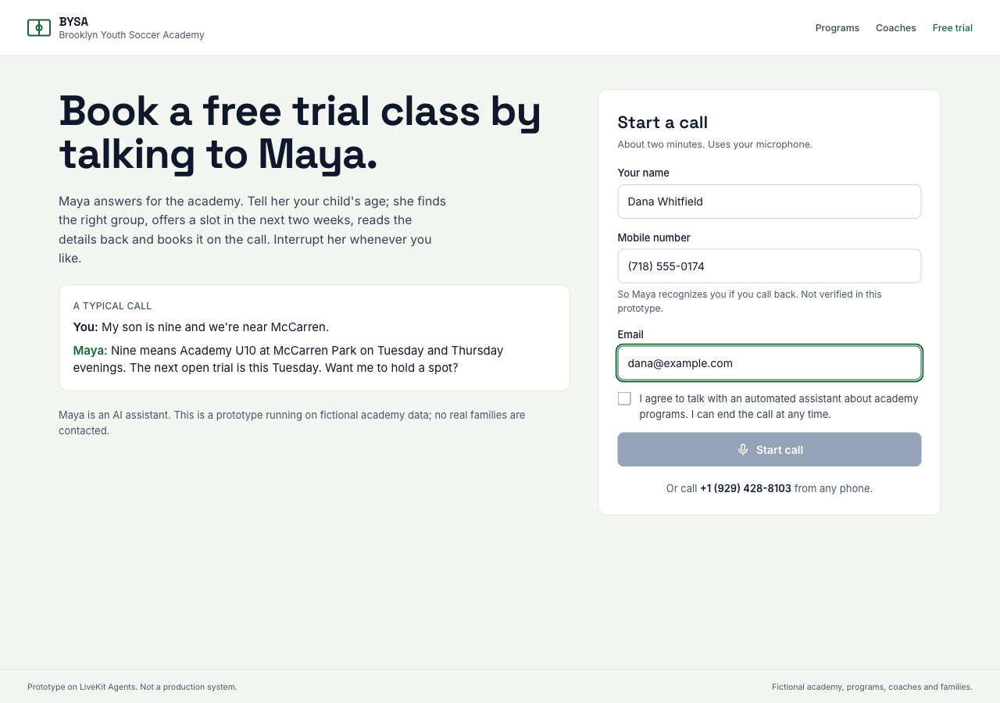
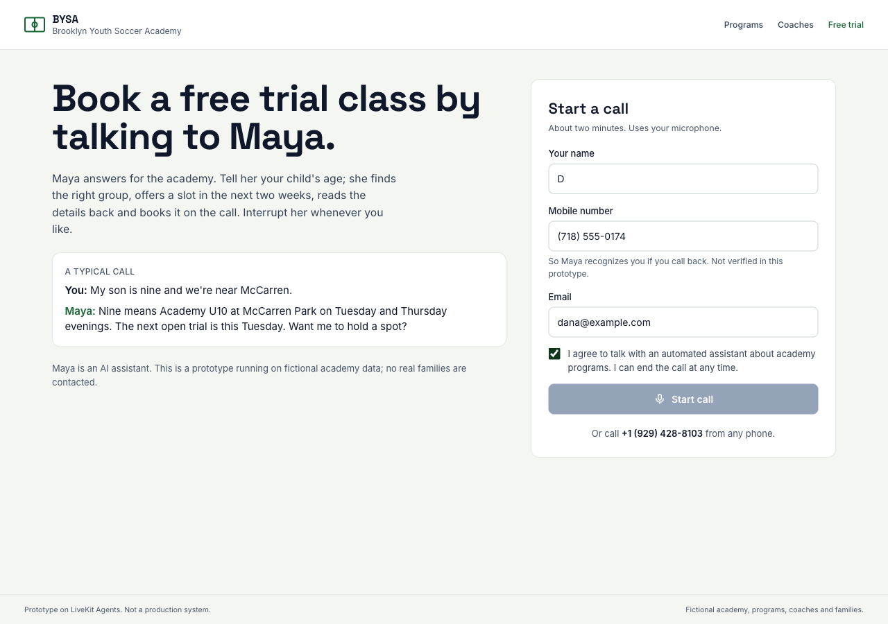

## B. New caller booking (phone 0171)

Expected: greeting, program lookup, slots, read-back, booking only after
"yes", Booked page with summary.

Happened:

1. Greeting: "Hi, I'm Maya, the AI enrollment assistant for Brooklyn Youth
   Soccer Academy; how can I help you with enrollment?"
2. Age 7 gave Juniors U8, $115 a month (`lookup_programs`, 8 ms).
3. Slots: Wed Nov 11 9:30 with Coach Priya, or 4 pm with Coach Luis
   (`check_trial_slots`).
4. "The first one works for us." gave `propose_booking` and the read-back
   "Just to confirm: a free trial for Emma, age seven, in Juniors U8 on
   Wednesday, November eleven at nine thirty ... Shall I book that?" The
   read-back turn has the left accent border. The aside shows "read back".
5. "Yes, please book it." gave `book_trial_class` (248 ms) and "Emma's free
   trial is set for Wednesday, November eleventh". The aside shows
   "consumed" (status line "Booked"); Family shows "Dana Whitfield, new
   record".
6. "That's all, thanks, bye." ended the call at 01:55 with the Booked page:
   "Emma's free trial is set for Wednesday, November 11.", confirmation
   BK-1BE9ADC5, details, summary text present on first read (no polling
   needed), step list ends with "Summary saved". After the reshoot fixes the
   step list uses plain labels ("Programs looked up", "Booking written")
   with the tool name in monospace, times count from the call start, and
   the memory line says what really happens: for this browser caller the
   summary is stored on the call and a new family record, and the next
   browser call starts fresh (only the demo family is reopened).

Result: PASS. Notes: the first typed line was "...seven and I'd like to
book a free trial." (the word "class" was left out). The booked page has no
latency table and no Braintrust link, which `design/parent-done.html`
shows. The summary text is saved to the family record; the booking row exists
(see G).

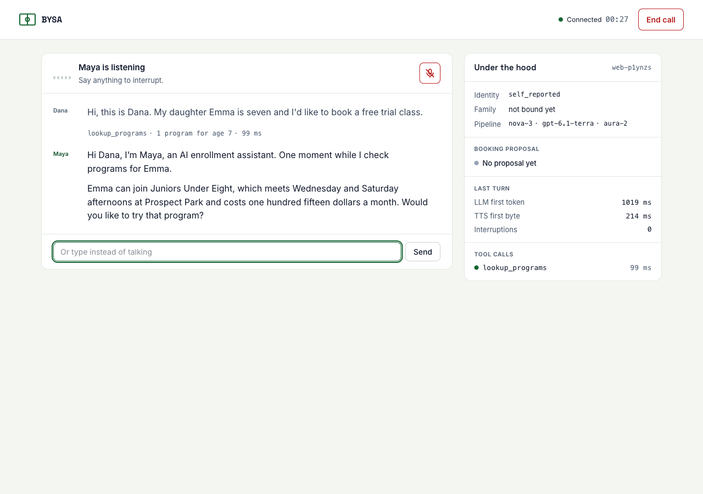
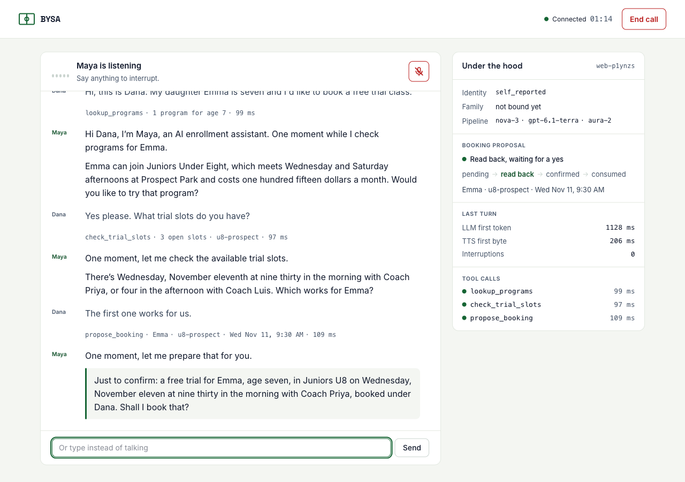
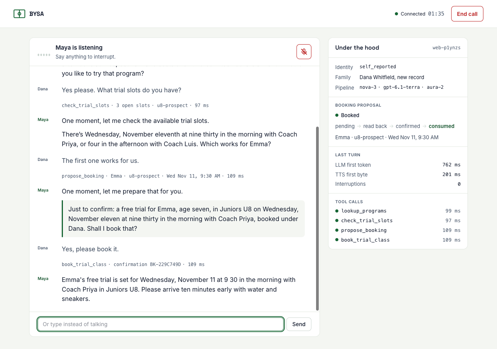
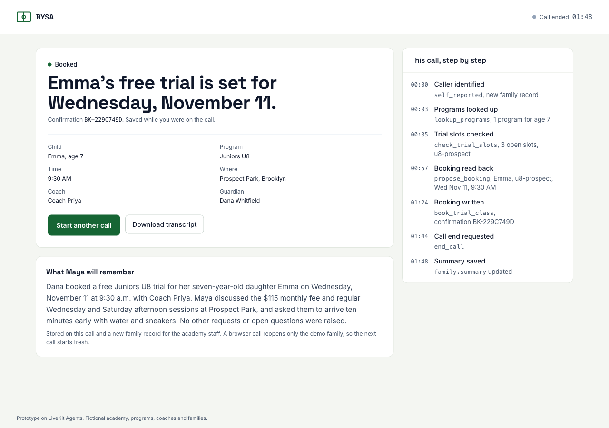

## C. Stray yes guard (phone 0172)

Expected: a non-yes turn after the read-back clears the proposal; a later
"Yes." books nothing; the end page says "No booking".

Happened:

- Read-back reached (same wording as B). Maya's greeting was cut by the first
  typed line (expected interruption).
- "Wait, is parking free there?" gave "I don't have information about
  parking there. Would you like me to ask the academy staff to call you
  back?" Aside: the proposal status reads "Cleared, nothing will be
  booked" with an orange dot, the steps are greyed out, and the reason
  sits on its own line ("Reason: reply to the read-back was not a clear
  yes."). Interruptions: 1.
- "Yes." was taken as the answer to the callback offer, not as a booking
  confirmation. The agent called `request_human_callback` and asked "Would
  you still like me to book Emma's trial?" No `book_trial_class` call.
- "Ok, no booking today, bye." ended the call at 01:39.

The end page headline is "Callback / The academy staff will call you back",
not "No booking", because the stray yes created a callback request. The
database confirms: call outcome `callback`, no booking, no family created
for 0172, one callback row ("Is parking free at Prospect Park for the trial
class?").

Result: PASS for the guard (nothing booked). The headline differs from the
expected "No booking" for the reason above.

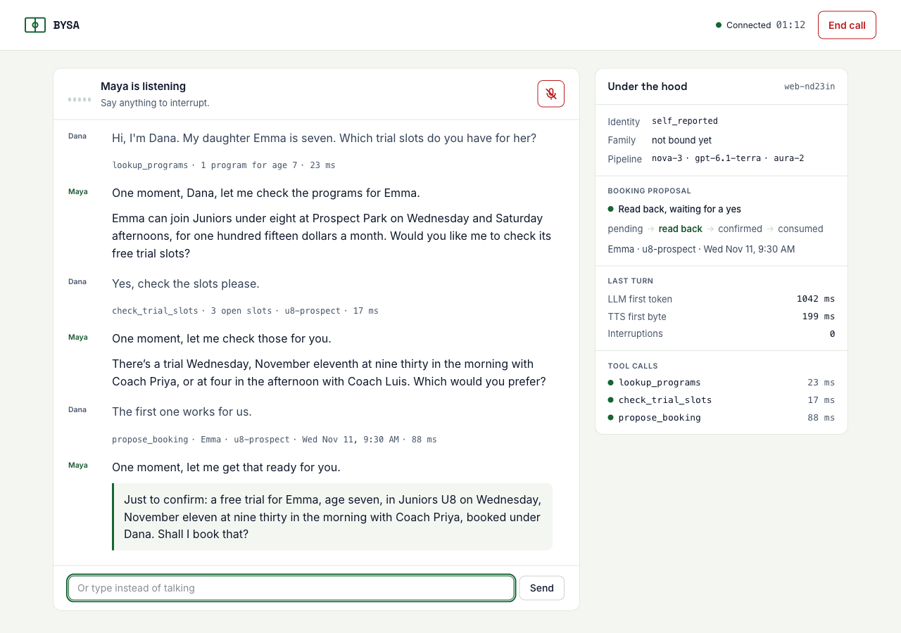
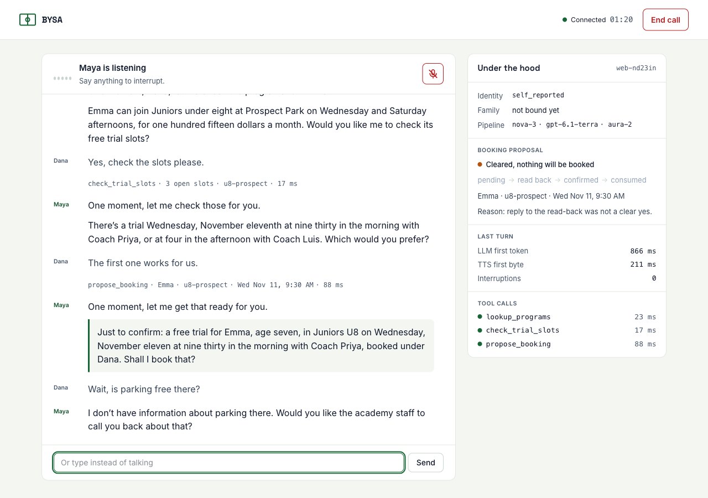
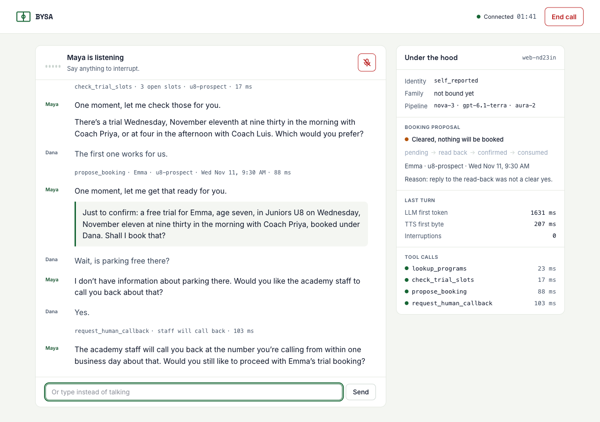
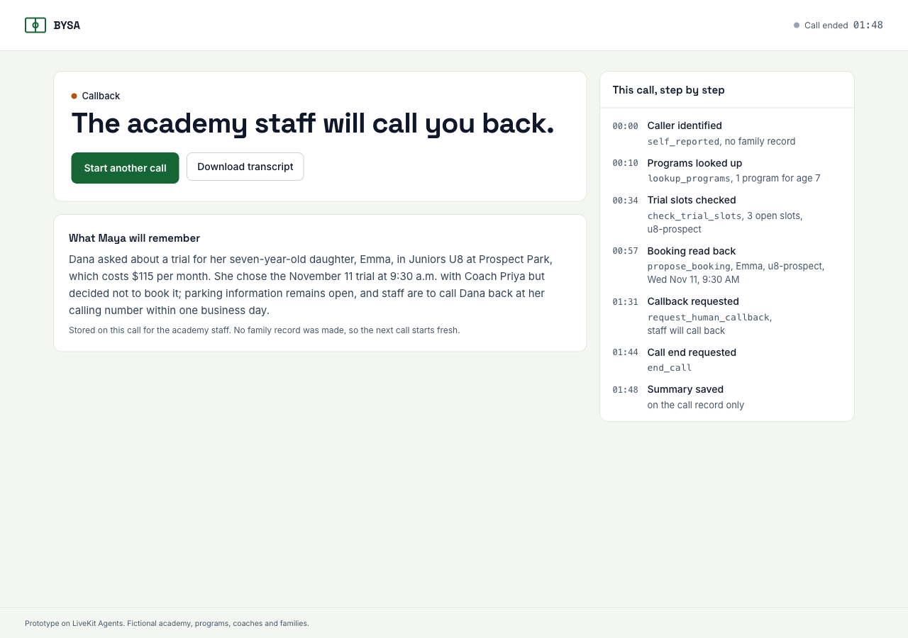

## D. Off-topic and grounding (phone 0173)

Expected: refusal or redirect for the poem; no invented fee; callback offer.

Happened:

- Poem: "I'm Maya, an AI assistant, and I can only help with academy programs
  and trial classes; what is your child's name?"
- Fee: "I don't have information about the annual registration fee. Would you
  like academy staff to call you back about it?" No number invented.
- Goodbye ended the call at 00:34, outcome "No booking". The `end_call`
  step now shows its real offset from the call start (00:25 of 00:30 in
  the reshoot; the first run showed 00:01 because step times counted from
  the first tool call).

Result: PASS. Note: the saved summary says "The caller did not provide a
guardian or child name", although the form name was Dana Whitfield. The
summary reads the conversation only.

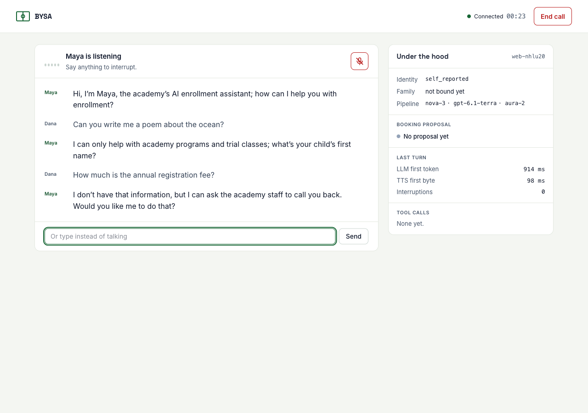
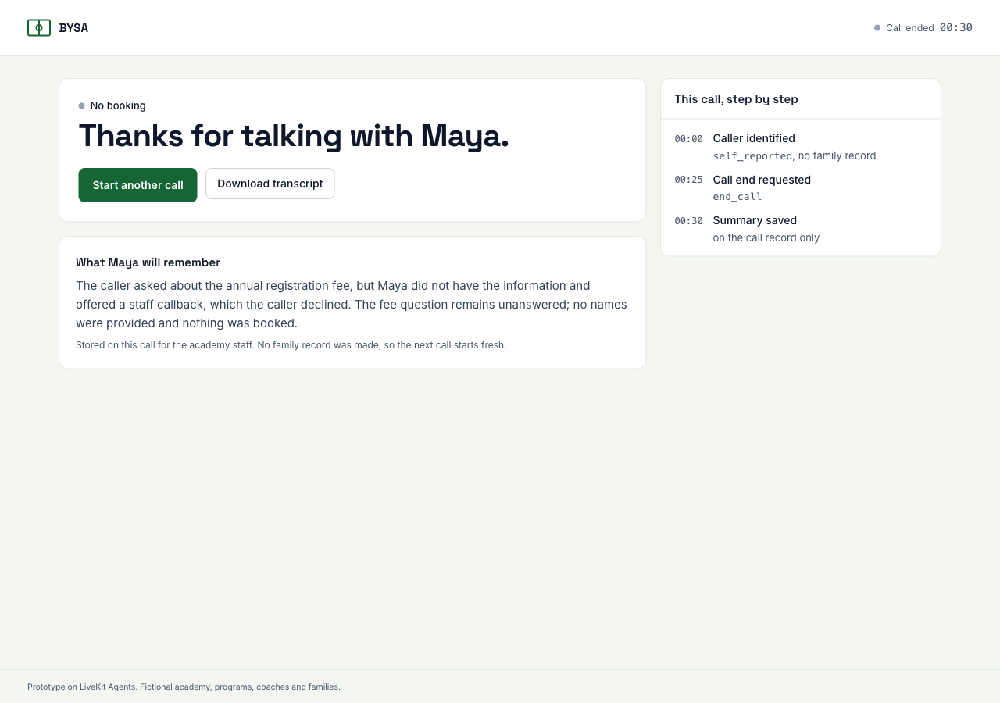

## E. Returning caller memory

A self-reported phone opens memory only for the seeded demo family
(`is_demo`). Its number is private, so that path was not exercised here. It
was verified by the phone calls in TASKS.md Phase 7 (the demo family was
greeted with its summary on both calls, identity `caller_id_only`) and by the
agent tests.

What this run shows: a second call with the SAME synthetic phone as B
(0171). The greeting is generic ("Hi, I'm Maya, the academy's AI enrollment
assistant; how can I help you with enrollment?"), the aside shows Family
"not bound yet", and the saved summary of that call mentions no earlier
booking. A
self-reported non-demo number gets a fresh record, no memory. The done page
now says so: "No family record was made, so the next call starts fresh."
It shows "read back to Maya at the start of the next call" only when the
family is a demo family or the caller came in by phone.

Result: PASS (non-demo path). The demo-family path is verified elsewhere,
not in this run. Side finding: families created from browser calls have a
null phone (the form phone is stored on `calls.phone` only), so a
self-reported phone could never match a family anyway.

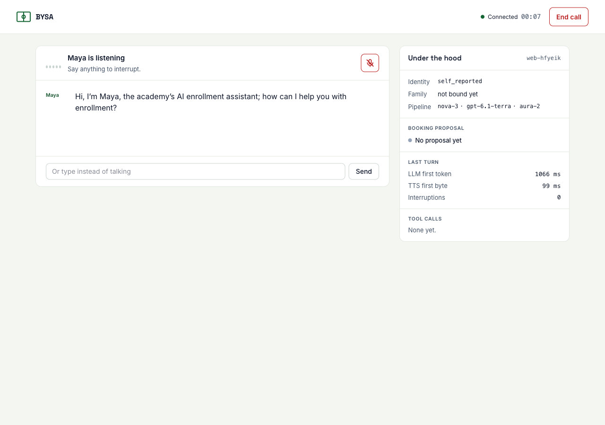

## F. API checks (curl)

| Request | Status | Body |
|---|---|---|
| POST /api/token, no Origin, `{}` | 403 | origin not allowed |
| POST /api/token, evil Origin | 403 | origin not allowed |
| POST /api/token, site Origin, `{}` | 400 | Invalid input: expected object... |
| Same, name "D" (full schema) | 400 | Enter your name |
| Same, no consent | 400 | Consent is required to start a call |
| GET /api/calls/not-an-id | 400 | bad id |
| GET /api/calls/0000...0000 | 404 | not found |
| GET /api/calls/c89035bd... (B) | 200 | keys call,family,booking |
| GET /api/calls/7e1e43f6... (C) | 200 | booking is null |

The call id is not on the booked page URL (URL stays `/`). I took ids from a
read-only query. The 200 response for B holds booking BK-1BE9ADC5 (Emma, 7,
Juniors U8, Coach Priya) and no phone field. No valid token was requested.

Result: PASS.

## G. Backoffice (tenant) view

The backoffice console is not built. These are design mockups only.

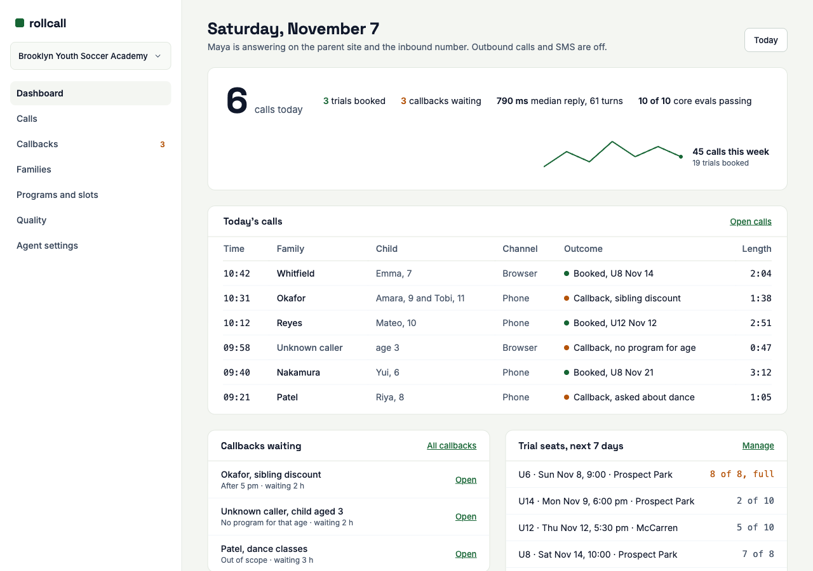
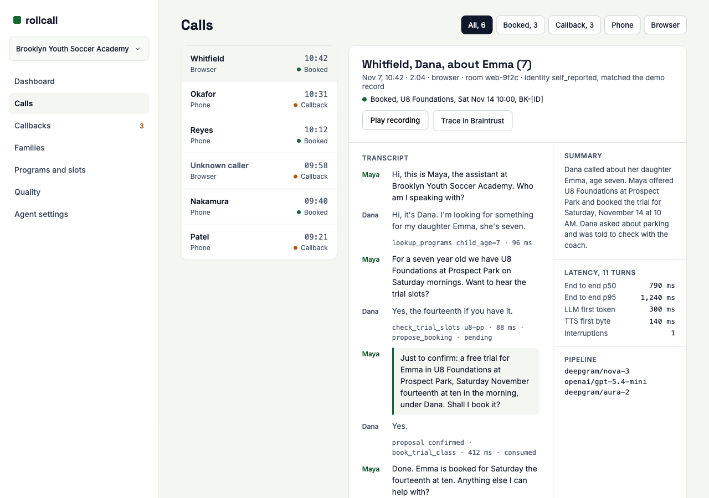
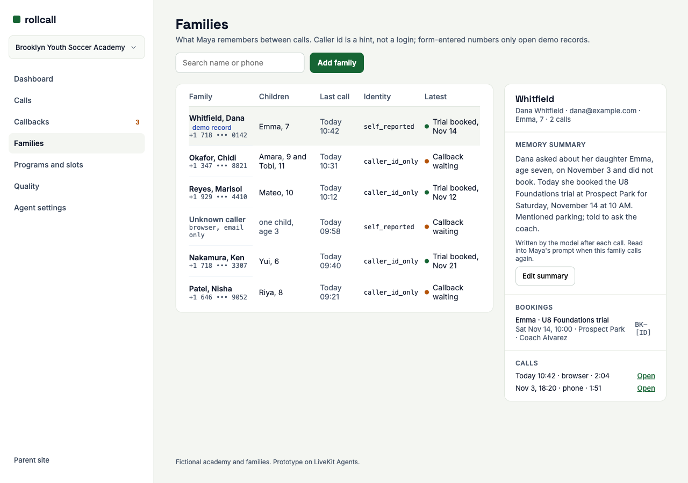

### What the tenant can see today

Supabase tables (read-only query, 2026-11-07 after the runs):

| Table | Rows |
|---|---|
| families | 5 (1 demo) |
| children | 5 |
| bookings | 5 |
| calls | 23 |
| callback_requests | 1 |

Last 5 calls (newest first, phones masked):

| Phone | Source | Outcome |
|---|---|---|
| +1 718 ••• 0171 | self_reported | inquiry |
| +1 718 ••• 0173 | self_reported | inquiry |
| +1 718 ••• 0172 | self_reported | callback |
| +1 718 ••• 0171 | self_reported | booked |
| [demo masked] | caller_id_only | inquiry |

Summary starts (first 120 characters, same order):

1. "The caller ended the call without discussing enrollment; neither the
   guardian's nor the child's name was provided. No ap"
2. "The caller did not provide a guardian or child name. They asked about the
   annual registration fee, which Maya could not "
3. "Dana asked about a free Juniors U8 trial for her seven-year-old daughter,
   Emma, and discussed the program schedule and $"
4. "Dana booked a free Juniors U8 trial for her seven-year-old daughter Emma
   on Wednesday, November 11 at 9:30 a.m. with Coa"
5. (empty)

The demo family number is masked on purpose.

Other sources (login required, not screenshotted):

- Braintrust: https://www.braintrust.dev/app/movo-voice-demo
- LiveKit Cloud sessions view (project movo-voice-demo)

## Notes and flaky items

- Transcript lines cut by interruptions are expected: the greeting was cut in
  C ("Hi, I'm Maya, the AI") and D, because typed input interrupts speech.
- Console errors on the live site: one 400 from `POST /api/token` at page
  load (`Room.prepareConnection failed ... Enter your name`, the prefetch runs
  before the form is filled), and DataChannel "User-Initiated Abort" errors at
  call end. Both are harmless.
- The "Maya" wait text matched the page copy before the call connected; I
  waited on "Under the hood" instead.
- Read-back wording varies between calls ("November eleven" vs "November 11
  at 9 30").
- Test data left in Supabase: 4 calls, 1 family, 1 booking (BK-1BE9ADC5)
  and 1 callback row, all synthetic.
