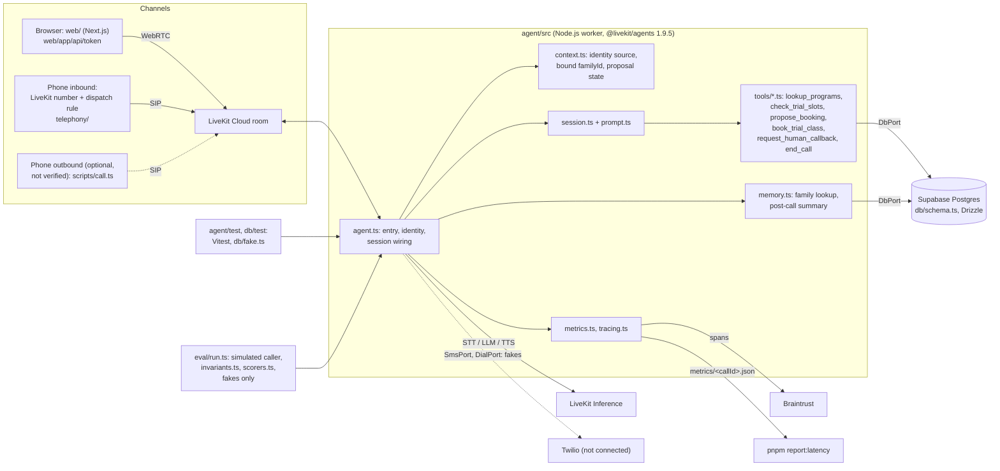

# README draft sections

Paste each section into README.md. Replace the placeholder sections "Architecture",
"Setup", "Cost estimate" and "What production would need". Facts marked (assumption)
are not from the PRD or the repo.

---

## Scope

This is a weekend prototype. It has production shape (ports, transactional writes,
identity rules, tests, evals, tracing) and prototype scope (one fictional academy,
synthetic data, free tiers). It is not production software.

What works today (verified in a real run, see Status):

- A browser call, typed or spoken, that books a trial class in Postgres.
- Returning-family memory and a post-call summary.
- The read-back protocol: a booking needs a confirmed proposal.
- Booking semantics (locking, idempotency) on real Postgres (`pnpm test:db`).
- One Braintrust span from a real call.

What is mocked:

- `SmsPort` and `DialPort` are fakes in every run, including live runs.
  `agent.ts` wires `FakeSmsPort` and `FakeDialPort`. No Twilio code runs.
- All family, program, price and slot data is synthetic.

What is not verified yet:

- Outbound calls. The Twilio trial trunk is not set up (`FEATURE_OUTBOUND=false`).
- SMS confirmation. No Twilio account is connected (`FEATURE_SMS=false`).
- An inbound phone call by a human to the LiveKit number, and the second-call
  recognition of the same phone (AC-6).
- The Cartesia voice (`LK_TTS_MODEL_RECORDING`). Only the Deepgram voice ran.
- Deployment to LiveKit Cloud with the laptop closed (AC-7).
- The 20-turn latency table (AC-4) and the cloud simulations.

Not in scope: payments, CRM, admin login, TCPA or HIPAA work, a live transfer to a
human, non-English, voicemail detection.

---

## Architecture

Notes:

- Tools read `familyId` from the session context only. Tool arguments never choose
  the family.
- Live runs use the Drizzle `DbPort`. Tests and evals use the in-memory
  `db/fake.ts`, so an eval cannot send an SMS or place a call.
- Dashed lines are paths that exist in code but are not exercised.

---

## Setup in 10 steps

Start from a clean macOS machine. You need accounts for LiveKit Cloud, Supabase
and Braintrust. Twilio is optional.

1. Install mise, then run `mise install` in the repo. This pins Node 24 and pnpm 12.
2. Run `brew install livekit-cli`, then `lk cloud auth`. Check with `lk project list`.
3. Run `cp .env.example .env`. Fill the lines marked FILL (LiveKit, Supabase,
   Braintrust). Never commit `.env`.
4. Run `pnpm install`. The build-script allow list is in `pnpm-workspace.yaml`.
5. Run `pnpm db:generate && pnpm db:migrate && pnpm db:seed`. Set
   `DEMO_RETURNING_PHONE` first, because the seed uses it for the demo family.
6. Run `pnpm test`, then `pnpm test:db`. Both must pass before you go on.
7. Run `pnpm -F agent dev`. The worker registers as `enroll-agent`.
8. In a second terminal, run `pnpm -F web dev`. Open http://localhost:3000.
9. Phone, optional: run `lk number search --country-code US`, then
   `lk number purchase --numbers +1...`. Run `pnpm telephony:render`, then
   `lk sip dispatch create --config telephony/out/dispatch-rule.json`. Assign the
   rule to the number in the dashboard (see Gotchas for the CLI failure).
10. Run `pnpm eval --profile core`. The scorecard prints to the terminal.

---

## Cost estimate

This is an estimate, not a tariff. Rates are the LiveKit Build plan figures from
the PRD (Nov 2026). Check LiveKit's pricing page before you rely on them.

Assumptions (all are assumptions, not measurements):

| Item | Value |
|---|---|
| Agent turns per call minute | 4 |
| LLM input tokens per turn | 2,000 (prompt, tools, history) |
| LLM output tokens per turn | 60 |
| Speech rate | 150 words/min, 6 chars/word = 900 chars/min |
| Agent speaking ratio | 0.4 (base), about 0.65 (high) |
| Agent TTS chars per call minute | 360 (base), 600 (high) |
| Prompt caching | none counted |

Derived per call minute: 8,000 input tokens and 240 output tokens.

Dev pipeline, USD per call minute:

| Line | Rate | Base | High |
|---|---|---|---|
| STT nova-3 | 0.0048/min | 0.0048 | 0.0048 |
| LLM gpt-6.1-terra | 1.00 in, 5.00 out /M tok | 0.0092 | 0.0092 |
| TTS aura-2 | 30 /M chars | 0.0108 | 0.0180 |
| Agent session | 0.01/min | 0.0100 | 0.0100 |
| Total | | 0.0348 | 0.0420 |

LLM base math: 8,000 x 1.00 / 1e6 = 0.0080, plus 240 x 5.00 / 1e6 = 0.0012.

Recording pipeline (TTS swapped to cartesia/sonic-3 at 50 per M chars):

| Line | Base | High |
|---|---|---|
| STT, LLM, session (as above) | 0.0240 | 0.0240 |
| TTS cartesia/sonic-3 | 0.0180 | 0.0300 |
| Total | 0.0420 | 0.0540 |

So the demo costs about 0.03 to 0.05 USD per call minute. The PRD gives about
0.036 and 0.048. Those use a cheaper LLM line (0.0030, gpt-5.4-mini) and a TTS
line of 0.018. Our LLM default is `gpt-6.1-terra` (see Decisions).

Comparison: hosted voice platforms charge about 0.07 to 0.33 USD per minute
(PRD figure, not re-checked). This stack is cheaper per minute, but you run and
maintain it yourself.

Free-tier limits (PRD section 15, hard caps): 1,000 agent minutes, 2.50 USD
inference credit, 50 inbound phone minutes, 5 concurrent sessions. If the credit
covers only STT, LLM and TTS (assumption), the dev pipeline uses
0.0248 USD per minute, so 2.50 USD lasts about 100 minutes.

| Service | Cost |
|---|---|
| Twilio trial (not connected) | 0 |
| Supabase free tier | 0 |
| Braintrust free tier | 0 |

---

## What production would need

- Concurrency and worker scaling: the demo has 5 sessions and 1 deployment. Add
  autoscaling, load tests and per-provider rate limits.
- Failover and provider fallback: one provider per stage today. Add fallbacks for
  STT, LLM and TTS, plus retry and degrade rules.
- TCPA consent capture: only a browser checkbox today. Store timestamped consent
  per channel before any SMS or outbound call.
- Recording consent: none today. Add a spoken or written notice, region rules and
  a retention policy.
- PII handling and redaction: transcripts are stored in `calls`. Redact traces and
  logs, encrypt data, set retention, support delete on request.
- Verified identity for web callers: form values are self-reported. Require OTP or
  an account link before any family record opens. Apply the same rule to phone
  callers, because caller id can be spoofed.
- Warm transfer: a callback request is the only hand-off today. Add SIP transfer
  to a human with context.
- Answering machine detection for outbound: `DialPort` is a fake. Add detection,
  calling-hours rules and an opt-out list.
- Regression evals from production calls: scenarios are hand-written today. Build
  new ones from real calls.
- Secrets management: `.env` today. Use a secrets manager, rotation and
  per-environment keys.
- Observability alerts: metrics are local JSON. Alert on latency, failed bookings,
  error rate and spend.

---

## Identity and trust

All family data in this demo is synthetic. Nobody can read real personal history
through it, because none exists. Production needs real verification first.

The worker decides how far to trust a caller from facts the server reports, never
from what the caller or the browser claims.

- `caller_id_only`: the room participant is a SIP participant, and the phone is
  the SIP caller id. It may load a family in the synthetic dataset. It is not
  verification, because caller id can be spoofed.
- `self_reported`: browser form values or outbound dispatch metadata. It may load
  a family only if that family is flagged `is_demo`. Otherwise the call starts
  with a new family.

(The level is stored in `calls.identity_source`.)

Rules:

- The participant kind decides the level. A `sip.phoneNumber` attribute alone does
  not make a call `caller_id_only`.
- The web token endpoint sets only four attributes: guardian name, phone, email,
  consent. It does not let the browser edit its own attributes or metadata.
- The bound family is set once at session start and lives in the session context.
  A tool argument cannot choose or change it.
- If a tool needs a family and none is bound, it creates one from the conversation.
- Details a tool collects for other reasons (a second guardian's phone) are
  ordinary data, not identity.
- Phones are stored in E.164. Validation uses `isPossible()`, so seeded `555`
  numbers pass.
- A must-pass eval invariant and a behavior test cover family isolation.
